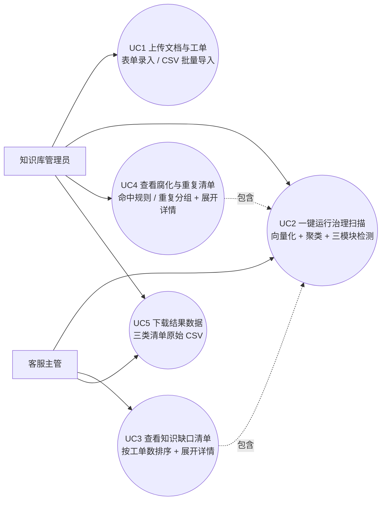
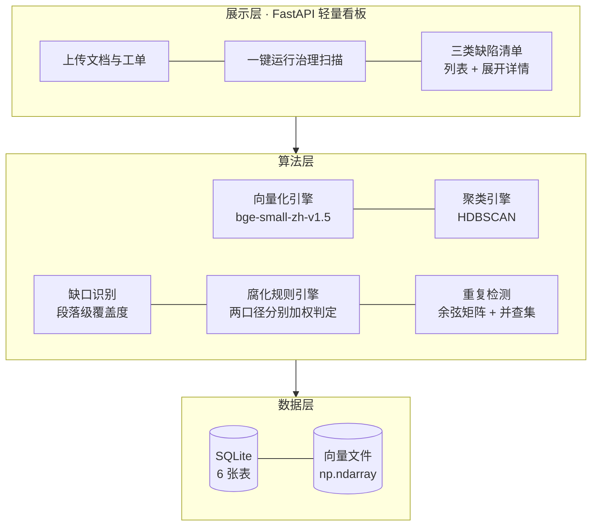
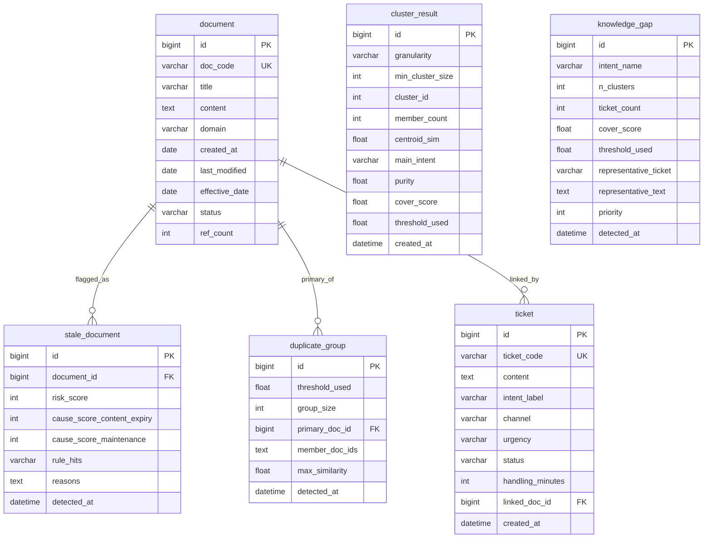

# 企业知识库质量治理系统 —— 毕业设计技术方案

> 文档用途：开题报告技术部分 / 硕士生开题汇报材料
> 撰写日期：2026-10-13
> 配套原型：`D:/26code/毕设/poc/kbgovernance/`（已完成全链路实测）
> 铁律说明：本文所有标注「实测」的数字均取自原型当前产物 `metrics.json`（耗时以此文件为唯一来源）、`ground_truth.json`、`granularity.csv`、`standardize/` 下的 CSV 与 JSON；凡属设计阶段尚未验证的内容，一律显式标注「**设计值，尚未实测**」或「**计划参数，非实测**」。**凡涉及耗时的数值均为本次实测值，跨机器必然波动，换机器重跑后须以新产物为准更新。**

---

## 第 1 章 项目背景与问题定义

### 1.1 三类真实痛点

企业把多年积累的制度、操作手册、FAQ 沉淀进知识库后，普遍出现三类随时间累积的质量问题。本方案的三类缺陷定义即来自对这一现象的抽象。

**痛点一：知识缺口（Knowledge Gap）** —— 员工遇到的问题，知识库里根本没有对应条目。典型现象是客服工单里出现一条问「境外出差住宿标准是多少」，而知识库 300 篇文档中没有一篇涉及境外差旅标准。客服只能凭经验回答，同一问题反复咨询，一线人员反复消耗工时。实测中此类工单占全部工单的 **18.55%**（371/2000，`ground_truth.json:gap_ticket_ratio=0.1855`）。

**痛点二：内容腐化（Content Staleness）** —— 文档还在，但内容已过期。典型现象是正文写着「本政策自2024年1月1日起施行，修订前版本同时废止」，而当前已是 2026 年；或文档 `last_modified` 停在 2022 年却仍在知识库前台可检索、仍被引用。过期文档比没有文档更危险——它会被检索命中并给出错误答案。

**痛点三：重复冗余（Redundancy）** —— 同一件事被不同部门以不同措辞反复写成多篇。实测原型中埋入了 22 组重复文档，组内版本仅措辞不同（「限于」→「仅限」、「须在」→「应当」），组内余弦相似度 0.9545–0.9845（`dup_groups_best.csv`，整篇级 22 组 max_sim 实际区间）。后果是检索结果被同质文档占满，真正的差异条款被淹没；维护时改了一处，另一处忘记改，直接产生互相矛盾的条款。

### 1.2 与 RAG 的区别（查重护城河）

这是本选题最需要防守的一条边界，必须在开题时讲清楚：

| 维度 | 本课题（知识治理） | RAG 类工作 |
|---|---|---|
| **目标** | 不回答问题，只治理知识库本身的质量 | 检索并生成答案 |
| **输出** | 缺陷清单（哪个意图缺文档 / 哪篇过期 / 哪组重复） | 自然语言答案 |
| **是否生成** | 否，全链路无生成模型 | 是 |
| **评测方式** | 对 ground truth 算 P/R/F1 | 答案正确性、人工评分 |
| **失败模式** | 阈值不稳、误报 | 幻觉、检索不准 |

RAG 的优化目标是「把对的文档送进生成器」，隐含前提是文档集合本身已经干净。本课题处理的是这个隐含前提本身。两者可以叠加（治理后的干净知识库再喂给 RAG），但研究对象、方法、评测体系完全不同，因此不构成重复劳动。

### 1.3 本文贡献（已完成实测，最终定稿）

1. **段落级语义覆盖度（已实测）**：把知识库检索粒度从整篇文档改为段落，意图级分离度 AUC 由 **0.8880 提升至 0.968**，工单级由 0.8307 提升至 0.8659（`granularity.csv`）。同时给出三种失败的统计变换方案（margin / max÷std / max÷top5，两种粒度下意图级 AUC 0.496–0.920，均低于同粒度基准），说明「在实测过的方案里，改变检索粒度收益最大」，而不是「改变粒度是唯一解法」。
2. **三模块治理系统（已实测）**：知识缺口 F1=**0.800**、内容腐化按两类口径分别报告——内容过期（R1 + R3）F1=**1.0000**、维护周期（R2 + R4）F1=**0.8986**，不合成单一 F1、重复冗余组级 F1=**0.7037**（0.90 阈值）/ 1.0000（0.95 阈值，乐观值）。三模块合计 3.46 秒（`metrics.json:total_seconds`）。
3. **三模块系统的实现（已实测）**：知识缺口、内容腐化、重复冗余三条检测链路全部落地并给出可核验指标，Web 侧提供上传、一键扫描与三类清单（详见 5.2 / 5.4 / 5.5 与第 4 章）。

**已完成但不计入本文贡献的探索（实测负结果）**：阈值可迁移性方向的全部实测结论已完成，但**不作为本文贡献、也不纳入论文题目**，因为实测发现它无法支撑一个算法改进点（详见 5.3 节定位说明）。三条实测结论记录如下，供答辩时说明「该方向试过、边界在此」：

- **形式化命题：单调等价性**：严格单调变换不改变 AUC，因此分位数、z-score、min-max 等「换刻度」方案**在数学上不可能**改进任何排序类指标；实测 Spearman ρ = **−1.000000** 佐证。
- **绝对阈值刻度的失效边界**：绝对阈值锚定的是「模型 × 语言」的刻度——同模型同语言内的**阈值刻度**极差仅 **0.0264**（很稳，但换语料 / 换规模后召回仍需重新核对，见 5.3.3 边界一），跨模型/跨语言则全线崩溃：中文 0.6463 搬到英文语料后，正向判定**一个缺口都检不出来**（F1 **0**，该场景自身最优 F1 为 0.8148），反向判定则 77 个意图**全部**误判为缺口（F1 0.3261）——两个方向都不可用。
- **一个诚实的负结果**：跨场景阈值极差可以被单独优化成假象（某方案极差仅 **0.0018**，但 AUC 仅 **0.1120**，比随机更差）——「可迁移」与「有效」是两个独立性质。

### 1.4 论文题目（已定稿）

**《基于语义聚类与时效性分析的企业知识库质量治理系统设计与实现》**

定稿依据见附录 A。本题只押一件事：**段落级语义覆盖度** + 三模块（缺口 / 腐化 / 重复）的完整系统实现。

**题目明确不承诺「阈值可迁移性评测」**，原因是该立论已被自己的实测推翻，写进题目就必须在答辩时回答一个无法回答的问题：

| 实测事实 | 出处 |
|---|---|
| 「严格单调变换不改变 AUC」是已知事实，作为算法改进点写不出新意；初稿预测最优的 S1/S2 在数学上就不可能赢，实测 Spearman ρ = −1.000000 | `standardize/mechanism.csv` |
| 领域内标准化（S3）在合成语料 α 上 AUC 1.0000，但在 banking77 上只有 **0.4344 / 0.4946**（同为真实语料、分别用 `bge-small-en-v1.5` 与 `bge-small-zh-v1.5` 嵌入，等同随机）；同一批实验中基线「绝对余弦阈值」为 **0.9538 / 0.7925**，全面占优 | `standardize/results_banking77_en.csv`、`results_banking77_zh.csv`、`results_auc.csv` |
| 「可迁移性」这个指标本身可被优化成假象：A2 方案跨场景阈值极差仅 **0.0018**（比基线 0.0264 小一个数量级），但 α 场景 AUC 仅 **0.1120**，比随机还差 | `standardize/results_directions.csv` |
| 固定检出比例的稳定性是以有效性为代价换来的：固定 25% 使跨场景 F1 标准差从 0.1452 降到 0.0873，但平均 F1 从 0.8289 掉到 0.5522 | `standardize/results_directionC.csv` |

**代价**：这条线要讲清楚需要一个整章篇幅（形式化命题 + 评测协议 + 边界表 + 度量陷阱），会挤掉系统实现本身；而题目一旦承诺了它，砍掉就变成「没做到」。因此它降级为 5.3 节的**探索性分析与负结果**，不作为本文贡献。

---

## 第 2 章 相关技术与研究现状

### 2.1 语义向量表示

**BGE 系列谱系**（BAAI General Embedding）按模型规模分为 bge-small / base / large / large-zh 等。选型如下：

| 模型 | 参数量 | 权重体积 | 维度 | 本机 CPU 实测吞吐 |
|---|---|---|---|---|
| bge-small-zh-v1.5 | 约 24M | 95.8 MB（`metrics.json:embedding.model_download_mb`） | 512 | 4152 条文本 / 14.61 秒 |
| bge-base-zh-v1.5 | 约 102M | 约 400MB | 768 | 未实测 |
| bge-large-zh-v1.5 | 约 326M | 约 1.3GB | 1024 | 未实测 |

**选型结论：bge-small-zh-v1.5。** 理由有三：① 本机为 8GB 显存的笔记本，小模型完全够用且无需 GPU；② 权重 95.8 MB 使换机器/换环境的成本几乎为零；③ 本课题的向量只用于「同域相似度比较」而非极限语义判别，小模型的精度损失可接受，而工程确定性（可复现、可移植）收益更高。

**模型冻结声明：本文主链路（指 §5.1 语义覆盖度、§5.2 知识缺口识别、§5.4 内容腐化检测、§5.5 重复冗余检测四个算法模块及其系统实现）的唯一向量模型是 `BAAI/bge-small-zh-v1.5`**，输出维度 512（`metrics.json:embedding.dim`），模型 id 见 `metrics.json:embedding.model`。§5.3 探索性分析（含 §5.3.3 的跨模型跨语言迁移实验）按设计需要临时换用另一份语料（其中英文目标场景另换模型），仅用于测量边界、**不进入主链路**，也不改变主链路的模型冻结。三条冻结口径必须同时成立：

- **设备固定为 CPU**。`embed.py` 与 `standardize/standardize.py` 均显式传 `devices="cpu"`，不依赖框架默认值。原因是 FlagEmbedding 在 `devices=None` 时会自动改用 CUDA——本机 torch 为 CPU 版，一旦换到装有 CUDA 版 torch 的机器，产物会在无人察觉的情况下换设备、刻度随之漂移。`embed.py` 会把实际使用的设备写入 `embeddings_meta.json` 的 `device` 字段，`detect.py` 原样带入 `metrics.json` 的 `embedding` 段（`metrics = {"embedding": emeta}`），不做额外校验；当前产物中 `metrics.json` → `embedding.device` = `cpu`，可按「文件路径 + 键名」复核。
- **阈值与「模型 × 语料 × 设备」三元组绑死**。缺口阈值 0.62 标定在该模型对本文中文语料的 CPU 编码结果上。BGE 模型卡明确建议「按自己数据上的相似度分布来选阈值」——这正对应下一段实测的基线偏高现象。§5.3.3 节的跨模型跨语言实测给出了这条绑定的代价：把中文语料上标定的覆盖度阈值（**0.6463**，即 `ablation.csv` 的「最优阈值」口径，与本文主链路的 0.62 不是同一口径）搬到 banking77 后，正向判定在目标语料上**一个缺口都检不出**（F1 = 0），而该场景自身最优 F1 是 0.8148 / 0.6207；0.62 比 0.6463 更低，落入的意图只会更少，结论方向不变。**换模型、换语料、换设备三者任一发生，阈值必须重新标定并重新落产物。**
- **云端可平替、阈值不需重标（有前提）**。本文选定的模型是公开权重模型（MIT 许可），HuggingFace 官方推理提供方目录中该模型 id 的 `feature-extraction` 端点状态为 `live`，即同一模型可直接经云端 HTTP API 调用。只要云端提供的仍是同一模型 id、且未对归一化方式与截断长度做改写，其输出向量与本地编码同源，**本文标定的阈值可以原样复用**；反之若云端换用其他模型或改写了编码细节，绑定关系即失效，必须按上一条重新标定。部署形态的取舍见 8.5 节。

**基线偏高问题**：实测发现 bge-small-zh-v1.5 的余弦相似度基线显著偏高——全部 2000 条工单的「被覆盖度」分布为 **min=0.5629 / mean=0.6891 / max=0.8294**。这意味着「完全没有对应文档」的工单，其最高相似度也有 0.563。这是第 5.3 节算法改进点的直接动因。

### 2.2 密度聚类：为什么是 HDBSCAN

HDBSCAN（Hierarchical Density-Based Clustering of Noisy Points）基于密度可达性构建层次簇结构，通过「稳定性」而非「距离阈值」切分簇。

**为什么不用 KMeans**：KMeans 需要预先指定簇数 K。本课题面对的是无标签客服工单，事先不知道有多少个业务意图——原型中 30 个意图，实际分出 **95 个簇**（min_cluster_size=5，`metrics.json` → `gap.clusters.5.n_clusters`），簇数是未知的，KMeans 无从下手。此外 KMeans 对离群点敏感，而工单数据天然含长尾噪声（实测 mcs=10 时有 9 条被标为噪声，`metrics.json` → `gap.clusters.10.n_noise`）。

**为什么不用 DBSCAN**：DBSCAN 的 eps 是全局单一值，在密度不均匀的语料上会把稀疏但真实的簇吞掉。HDBSCAN 通过层次化密度结构自适应处理不同密度的簇。

### 2.3 混合检索与 RRF（作为对比，不采用）

RRF（Reciprocal Rank Fusion）通过各检索器的排名倒数融合多路召回结果：
$$RRF(d)=\sum_{r\in R}\frac{1}{k+\text{rank}_r(d)}$$
它适用于「关键词召回 + 向量召回」的多路融合。本课题只用单路向量检索，不存在多路融合需求，因此不引入 RRF，以免增加无关复杂度。

### 2.4 研究现状

- **检索 / RAG 方向已高度饱和**：DPR、RAG、BGE-M3 等工作密集产出，评测集与基线高度趋同。
- **知识治理方向近乎空白**：中文公开文献中，「基于工单反向驱动知识库治理」的系统性研究几乎没有，既无标准数据集也无公认评价体系。这正是本课题的创新空间，也解释了为什么必须自建 ground truth。

---

## 第 3 章 需求分析

### 3.1 可行性分析

**技术可行性（已实测验证）**：三模块全链路在目标硬件上跑通。实测：生成数据秒级完成；向量化 4152 条文本（300 篇文档 + 2000 条工单 + 1852 个文档段落，三项与 `metrics.json:embedding` 的 `n_docs` / `n_tickets` / `n_passages` 逐项对齐）耗时 **14.61 秒**；三模块检测合计 **3.46 秒**。全程 CPU，无 GPU 训练，无 7B 以上模型。耗时取自当前 `metrics.json`，跨机器必然波动，此处只描述本次实测状态。

**数据可行性（已实测验证）**：原型已构造 300 篇文档 / 2000 条工单 / 8 业务域 / 30 意图的语料，三类缺陷均已按可公开说明的规则埋入并被检出——缺口 F1=0.800（阈值 0.62）、腐化两类口径分别为内容过期 1.0000 与维护周期 0.8986（取自 `metrics.json` 的 `corrupt.by_cause`，不合成单一 F1）、重复在 0.95 阈值下组级 F1=1.0000，缺口与重复两值取自 `gap.best` / `dup.best`。语料的缺陷埋设位置逐条记录在 `ground_truth.json`，可追溯到生成规则。

**工程可行性（已实测验证）**：存储层为 SQLite 的 6 张表加一份向量 `np.ndarray` 文件；重复检测环节实测耗时 `metrics.json:dup.seconds` 为 0.0 秒，说明当前文档规模不需要引入独立向量数据库。展示层为 FastAPI 单进程同步接口，无任务队列、无外部服务依赖，启动只需一条 `python -m uvicorn` 命令。

**时间可行性（计划估算，非实测）**：开发窗口为 **W1–W10（10 周）**，排期以《本科版实施方案.md》第 6 章为唯一权威版本。瓶颈不是编码而是人工标注（预算 300 条，其中至少 100 条需双人独立标注），该项长度不可压缩、起点不可控，已排为 W3 关键路径。

### 3.2 用例图

系统的使用者只有两类：负责维护知识库内容的知识库管理员，以及消费缺陷结果的客服主管。系统对外只暴露三个功能面——上传文档与工单、一键运行治理扫描、三类缺陷清单（列表 + 展开详情）——因此用例图只画这三个功能面及其支撑用例。



### 3.3 用例说明表

| 编号 | 名称 | 参与者 | 前置条件 | 基本流 | 异常流 |
|---|---|---|---|---|---|
| UC1 | 上传文档与工单 | 知识库管理员 | 服务已启动，SQLite 6 张表已建 | 1) 录入文档标题/正文/业务域/生效日期并保存 2) 批量导入工单 CSV 并解析意图标签 3) 分别落入 `document` 与 `ticket` 两表 | ① 正文过短（<20 字）拒绝入库 ② 工单 CSV 缺列时提示正确表头并中止导入 |
| UC2 | 一键运行治理扫描 | 知识库管理员 / 客服主管 | 库中已有文档与工单 | 1) 点击「运行扫描」 2) 段落切分并向量化 3) 对工单做 HDBSCAN 聚类 4) 依次执行缺口、腐化、重复三项检测 5) 结果落库并刷新三类清单 | ① 库中无数据则拒绝启动 ② 扫描超时则提示并保留上一次结果 |
| UC3 | 查看知识缺口清单 | 客服主管 | 已有扫描结果 | 1) 打开缺口页 2) 按业务意图浏览缺口意图（判定单元 = 业务意图，簇数不作为主指标）3) 展开某条查看该意图下的簇明细、代表工单样例与段落级覆盖度 4) 下载 `gap_intents_best.csv`（意图级主清单）与 `gap_clusters_best.csv`（簇级明细） | ① 尚无扫描结果则提示先运行扫描 |
| UC4 | 查看腐化与重复清单 | 知识库管理员 | 已有扫描结果 | 1) 在腐化页按内容过期 / 维护周期两个口径分别查看判定指标与命中规则组合 2) 在重复页查看各重复分组与主文档选举结果 3) 展开条目查看完整字段 4) 下载 `corrupt_docs.csv` 与 `dup_groups_best.csv` | ① 重复组内未选出唯一主文档时按选举规则降级并标注待人工确认 |
| UC5 | 下载结果数据 | 知识库管理员 / 客服主管 | 已有扫描结果 | 1) 在三类清单页点击下载 2) 系统直接返回扫描时已落盘的 CSV 原始文件 | ① 产物文件缺失则提示重新运行扫描 |

### 3.4 角色功能矩阵

| 功能 | 知识库管理员 | 客服主管 |
|---|---|---|
| UC1 上传文档与工单 | ✔ | ✖ |
| UC2 一键运行治理扫描 | ✔ | ✔ |
| UC3 查看知识缺口清单 | ✔ | ✔ |
| UC4 查看腐化与重复清单 | ✔ | ✔ |
| UC5 下载结果数据 | ✔ | ✔ |

两列的差异只体现业务职责分工，不构成访问控制——本系统不设登录与权限体系。

### 3.5 非功能需求

| 指标 | 目标值 | 依据 |
|---|---|---|
| 单次全量扫描耗时 | ≤ 60 秒（2000 工单规模） | 本次实测检测环节 3.46 秒，向量化 14.61 秒，留足余量 |
| 页面响应时间 | ≤ 2 秒 | 纯查询与聚合，无大模型推理 |
| 数据规模支持 | 2000 条工单 / 300 篇文档（已实测口径） | **本系统面向中小型企业单个知识域**；进一步扩量不属于本文范围 |
| 部署依赖 | **本地单机**：单进程 + SQLite，无外部服务 | 存储层为 6 张表加向量文件，检测环节实测 `dup.seconds` 为 0.0 秒；本课题以本地跑通为准，不要求线上部署，部署形态的取舍见 8.5 节 |
| 结果可复现性 | 同一输入重复扫描，三类清单与主指标一致，仅耗时字段允许波动 | `run_all.sh` 复跑后 CSV 与 `metrics.json` 除耗时字段外逐字节相同 |
| 并发量 | **不涉及高并发** | 内部单知识域工具，设计并发 ≤ 5 |

> 诚实说明：本系统定位为**中小型企业单个业务域的知识治理工具**，数据量在千级至万级，不做高并发设计。这不是能力不足，而是场景决定的正确定位；把并发指标写高反而会被追问而无法自圆其说。

---

## 第 4 章 系统总体设计

### 4.1 系统架构



三层结构与裁剪后范围一致：展示层只保留上传、一键扫描、三类缺陷清单三个入口；算法层为向量化 + 聚类 + 三模块检测，五者由「一键扫描」同步串行调用；数据层落 SQLite 的 6 张表，向量以 `np.ndarray` 文件形式单独保存，不引入独立的向量数据库。

### 4.2 功能模块划分（7 个）

| # | 模块 | 职责 | 输入 | 输出 | 关键类 |
|---|---|---|---|---|---|
| M1 | 文档管理 | 知识文档上传与元数据维护 | 文档表单 / 上传文件 | 文档记录 | `DocumentService` |
| M2 | 工单导入 | 批量导入客服工单并解析意图标签 | CSV/JSON | 工单记录 | `TicketImporter` |
| M3 | 向量化引擎 | 段落切分 + 文本编码 + L2 归一化 | 文档/工单文本 | 向量矩阵 | `EmbeddingEngine` |
| M4 | 聚类引擎 | HDBSCAN 密度聚类 | 工单向量 | 簇标签 | `TicketClusterer` |
| M5 | 缺口识别 | 段落级覆盖度计算 + 阈值判定 + 优先级排序 | 簇 + 文档向量 | 缺口清单 | `GapDetector` |
| M6 | 腐化规则引擎 | 4 条时效性规则匹配 + 按内容过期 / 维护周期两口径分别加权判定 | 文档元数据+正文 | 腐化清单 | `StaleRuleEngine` |
| M7 | 重复检测 | 余弦矩阵 + 并查集 + 主文档选举 | 文档向量 | 重复分组 | `DuplicateDetector` |

「功能面」是看板上的用户入口，共三个：上传文档与工单、一键运行治理扫描、三类缺陷清单（列表 + 展开详情）；「模块」是这三个入口背后的内部分层。两者不是一一对应关系——M3–M7 五个算法模块全部由「一键扫描」这一个功能面同步串行调用，其产物分别落到三类清单上。

### 4.3 数据库设计



六张表分成两组：`document` / `ticket` 是扫描的输入语料，`cluster_result` / `knowledge_gap` / `stale_document` / `duplicate_group` 是三模块检测的落库目标，对应看板「三类缺陷清单」三个页面。`cluster_result.granularity` 记录该簇是在 `passage_level` 还是 `doc_level` 粒度下算出的，用于保留段落级与整篇级两套结果；`cluster_result.threshold_used` 记录该轮扫描采用的覆盖度阈值（当前实测最优为 0.62）。`duplicate_group.member_doc_ids` 以 JSON 数组存组内成员文档 ID，避免为「重复组—文档」的多对多关系再引入第七张中间表。

两张表的形态按现行口径做过更正（详见 §5.2.2.1 与 §5.4）：

- `knowledge_gap` 的**判定单元是业务意图**，不是簇。缺口清单的一行 = 一个业务意图，`cover_score` 存的是该意图下各簇覆盖度的**最小值**（意图覆盖度），`n_clusters` 是该意图下的簇数，`ticket_count` 是该意图下的工单总数。因此它不再有指向 `cluster_result` 的外键——一个意图对应多个簇，外键表达不了。意图行与簇行的对应靠 `knowledge_gap.intent_name` ↔ `cluster_result.main_intent` 的软链接口径，簇级明细（簇号、簇覆盖度、簇内工单数）留在 `cluster_result` 里供溯源。
- `stale_document` 的判定按**两类口径各自独立打分**：`cause_score_content_expiry` 是内容过期口径（R1 + R3）的加权分，`cause_score_maintenance` 是维护周期口径（R2 + R4）的加权分，各 ≥ 3 时该篇在该口径下命中。`risk_score` 保留为四条规则的合并加权分，只作溯源与对照，不再用于任何判定。

**表结构 DDL**

```sql
PRAGMA foreign_keys = ON;

CREATE TABLE document (
  id             INTEGER PRIMARY KEY AUTOINCREMENT,
  doc_code       TEXT    NOT NULL UNIQUE,
  title          TEXT    NOT NULL,
  content        TEXT    NOT NULL,
  domain         TEXT,
  created_at     TEXT    NOT NULL,
  last_modified  TEXT    NOT NULL,
  effective_date TEXT,
  status         TEXT    NOT NULL DEFAULT '生效',
  ref_count      INTEGER NOT NULL DEFAULT 0
);
CREATE INDEX idx_doc_mtime ON document(last_modified);
CREATE INDEX idx_doc_domain ON document(domain);

CREATE TABLE ticket (
  id               INTEGER PRIMARY KEY AUTOINCREMENT,
  ticket_code      TEXT    NOT NULL UNIQUE,
  content          TEXT    NOT NULL,
  intent_label     TEXT    NOT NULL,
  channel          TEXT,
  urgency          TEXT,
  status           TEXT,
  handling_minutes INTEGER,
  linked_doc_id    INTEGER NULL REFERENCES document(id),
  created_at       TEXT    NOT NULL
);
CREATE INDEX idx_ticket_intent ON ticket(intent_label);
CREATE INDEX idx_ticket_time ON ticket(created_at);

CREATE TABLE cluster_result (
  id                INTEGER PRIMARY KEY AUTOINCREMENT,
  granularity       TEXT    NOT NULL DEFAULT 'passage_level',
  min_cluster_size  INTEGER NOT NULL,
  cluster_id        INTEGER NOT NULL,
  member_count      INTEGER NOT NULL,
  centroid_sim      REAL,
  main_intent       TEXT,
  purity            REAL,
  cover_score       REAL,
  threshold_used    REAL,
  created_at        TEXT    NOT NULL
);
CREATE INDEX idx_cluster_gmcs ON cluster_result(granularity, min_cluster_size);
CREATE INDEX idx_cluster_intent ON cluster_result(main_intent);

CREATE TABLE knowledge_gap (
  id                    INTEGER PRIMARY KEY AUTOINCREMENT,
  intent_name           TEXT    NOT NULL,
  n_clusters            INTEGER NOT NULL,
  ticket_count          INTEGER NOT NULL,
  cover_score           REAL    NOT NULL,
  threshold_used        REAL    NOT NULL,
  representative_ticket TEXT,
  representative_text   TEXT,
  priority              INTEGER NOT NULL DEFAULT 0,
  detected_at           TEXT    NOT NULL
);
CREATE INDEX idx_gap_score ON knowledge_gap(cover_score);
CREATE INDEX idx_gap_intent ON knowledge_gap(intent_name);

CREATE TABLE stale_document (
  id          INTEGER PRIMARY KEY AUTOINCREMENT,
  document_id INTEGER NOT NULL REFERENCES document(id),
  risk_score  INTEGER NOT NULL,
  cause_score_content_expiry INTEGER NOT NULL DEFAULT 0,
  cause_score_maintenance   INTEGER NOT NULL DEFAULT 0,
  rule_hits   TEXT,
  reasons     TEXT,
  detected_at TEXT    NOT NULL
);
CREATE INDEX idx_stale_score ON stale_document(risk_score);
CREATE INDEX idx_stale_cause_expiry ON stale_document(cause_score_content_expiry);
CREATE INDEX idx_stale_cause_maintenance ON stale_document(cause_score_maintenance);

CREATE TABLE duplicate_group (
  id              INTEGER PRIMARY KEY AUTOINCREMENT,
  threshold_used  REAL    NOT NULL,
  group_size      INTEGER NOT NULL,
  primary_doc_id  INTEGER NOT NULL REFERENCES document(id),
  member_doc_ids  TEXT    NOT NULL,
  max_similarity  REAL,
  detected_at     TEXT    NOT NULL
);
CREATE INDEX idx_dup_threshold ON duplicate_group(threshold_used);
```

日期与时间统一以 ISO-8601 文本存 SQLite 的 `TEXT` 列，比较时按字典序即等价于按时间序，索引仍可用。

### 4.4 技术选型对比

| 能力 | 候选 | 选型结论 | 理由 |
|---|---|---|---|
| 后端框架 | FastAPI / Flask / Django | **FastAPI** | 自带 OpenAPI 文档与类型校验，与 numpy/PyTorch 无冲突 |
| 前端 | Vue3 / React / 服务端渲染 | **Vue3 + Element Plus**（设计值，尚未实测） | 组件成熟，国内资料多 |
| 数据库 | 独立数据库服务 / 嵌入式数据库 | **SQLite**（设计值，尚未实测） | 系统是单用户、单进程、6 张表的内部工具，全量扫描在请求内同步跑完（实测三模块检测 3.46 秒，向量化 14.61 秒），不存在多连接写入压力；SQLite 免安装、免部署、零外部依赖，答辩现场可直接复制 `metrics.json` 同目录的 `.db` 文件复现。 |
| 向量存储 | Faiss / Milvus / 直接 numpy | **直接 numpy**（已实测） | 文档数实测为 300 篇（`metrics.json` → `embedding.n_docs`），300×300 余弦矩阵实测耗时 < 0.01 秒（`metrics.json` → `dup.best.seconds` 记为 0.0，运行日志记为 0.00s），此规模下引入 Faiss/Milvus 只会增加部署依赖而不带来任何检索收益；向量以 `np.ndarray` 文件保存，加载即用，无需常驻服务，与数据层 6 张表的轻量口径一致。**「什么规模、什么需求下才该上向量库」的边界论证见 5.5.1 节。** |
| 向量模型 | bge-small-zh / bge-base-zh / bge-large-zh | **bge-small-zh-v1.5**（已实测） | 本文主链路（§5.1 / §5.2 / §5.4 / §5.5 四个算法模块及系统实现）的**唯一向量模型**，模型冻结口径（设备固定、阈值绑定「模型 × 语料 × 设备」三元组、云端平替的前提）见 2.1 节 |
| 聚类算法 | HDBSCAN / KMeans / DBSCAN | **HDBSCAN**（已实测） | 见 2.2 节 |

---

## 第 5 章 核心算法设计（本文重点）

### 5.1 语义覆盖度计算（本文唯一的算法改进点：段落级检索）

**5.1.1 段落级切分策略**

整篇文档直接编码会把多个主题平均掉。实测：300 篇文档平均 140 字、正文按 `。` 与 `；` 切分后平均 5.2 句，整篇编码时**意图级分离度 AUC 仅 0.8880**（工单级 0.8307）。切分时丢弃长度 < 8 字的片段（含标题段），得到 **1852 个段落，平均每篇 6.2 段**（`metrics.json:embedding.n_passages` = 1852 ÷ 300 篇 = 6.17），分离度 AUC 提升至 **0.968**（工单级 0.8659），意图级绝对提升 0.0800、相对提升 9.0%（`granularity.csv`）。

**5.1.2 段落级 max-cosine 聚合到文档级**

**数学定义**：设文档集合 $D=\{d_1..d_{M}\}$，文档 $d_i$ 被切分为段落集 $P_i=\{p_{i,1}..p_{i,k_i}\}$。工单 $t$ 对文档 $d_i$ 的覆盖度定义为

$$\text{cover}(t, d_i)=\max_{p \in P_i}\ \cos\big(\mathbf{e}(t),\ \mathbf{e}(p)\big)$$

工单 $t$ 的整体被覆盖度为 $\text{cover}(t)=\max_{d_i \in D}\ \text{cover}(t, d_i)$。

注意这是**两级 max 聚合**（先段落内、再文档间），正是这一结构让「一篇文档只讲一个子主题」不再被平均掉。

**分段聚合技巧**：由于切分时按文档顺序处理，段落在数组中天然连续（doc0 的全部段落、doc1 的全部段落……），因此可用分段最大值 `np.maximum.reduceat` **一次性**完成从段落级到文档级的聚合，无需任何 Python 循环：

```python
SP    = T @ P.T                                  # (n_tickets, n_passages) 余弦
start = np.searchsorted(owner, np.arange(n_docs), side='left')
cover = np.maximum.reduceat(SP, start, axis=1)   # (n_tickets, n_docs)
ticket_cover = cover.max(axis=1)                 # 每条工单的覆盖度
```

`reduceat` 要求索引严格递增且覆盖连续区间。由于每篇文档至少保留 1 个段落（切分后若为空则回退为整篇），区间连续性天然成立；实现中额外加入 `ends <= starts` 的空文档断言，防止边界数据导致静默错位。

**复杂度**：段落级检索 $O(N_t \times N_p)$，2000×1852 的矩阵乘法实测为秒级；相比之下「对每条工单单独遍历段落」的朴素写法是 $O(N_t \times N_p)$ 次 Python 级索引开销，慢 2–3 个数量级。

**5.1.3 打分方案对照：统计变换为什么无效（失败数据同样是贡献）**

为验证「是不是换个归一化就能救回绝对阈值」，在**两种检索粒度上**分别实测了三种朴素统计变换，外加一个 max−min 极差方案作为反例，意图级分离度如下（`granularity.csv`）：

| 打分方案 | 数学定义 | 段落级 AUC | 整篇级 AUC | 结论 |
|---|---|---|---|---|
| max-cosine（基准） | $\max \cos(t, \cdot)$ | **0.968** | 0.8880 | **采用** |
| margin | $\max - \text{mean}(\text{top5})$ | 0.9200 | 0.8320 | 弱于同粒度基准 |
| 标准化离群 | $\max / \text{std}$ | 0.7040 | 0.4960 | 失败 |
| 比值归一 | $\max / \text{mean}(\text{top5})$ | 0.8880 | 0.7760 | 失败 |
| 极差 | $\max - \min$ | 0.8800 | 0.9280 | 随粒度反转，见下 |

**为什么同一个公式在两种粒度下差这么多**：这些变换都依赖 top5 候选分布的形状，而段落级下候选数从 300 变成 1852，max 命中的段落与 top5 段落的相似度落差更小、更稳定，margin 与比值类变换因此受益；整篇级下候选池小、分布离散，除以 std 或除以均值会被少数极端值主导，直接塌向随机水平（max÷std 仅 0.496）。**结论不能跨粒度搬运**，必须逐粒度报告。

**这组失败实验的价值在于**：在实测过的全部方案里，可用的意图级分离度信号几乎全部来自 max-cosine 本身——margin / max÷std / max÷top5 在两种粒度下均低于同粒度基准，这排除了「换个归一化就能提升分离度」这条路，支撑了把段落级检索作为第一改进点，也堵死了评审可能提出的「你为什么不试试别的归一化」。

**必须如实说明的反例**：极差（max−min）是唯一一个不服从「统计变换必然变差」的方案——整篇级下它的意图级 AUC 0.928 反而高于整篇级基准 0.8880，但同一方案在工单级上从 0.8307 掉到 0.7829，段落级下也从 0.968 掉到 0.8800。因此论文中不应写「改变粒度是唯一解法」，准确表述是：**在实测范围内，改变检索粒度带来的意图级提升（+0.0800）大于任何单一统计变换带来的提升，而最优统计变换随粒度反转、不稳定。**

### 5.2 知识缺口识别

**5.2.1 聚类实测数据**

| min_cluster_size | 簇数 | 噪声工单 | 耗时 | 最优 F1 |
|---|---|---|---|---|
| 5 | 95 | 0 | ≈1 秒级 | 0.800 |
| 10 | 88 | 9 | ≈1 秒级 | 0.800 |

> **耗时口径说明**：HDBSCAN 聚类耗时受机器负载影响，波动约 ±25%，且该值未写入 `metrics.json`（当前产物只记录 `total_seconds` 与 `corrupt.seconds`），因此**只报量级（约 1 秒级）**，不引用具体数值。簇数与噪声条数是可复现的确定性结果，已落盘 `metrics.json` → `gap.clusters`（mcs=5 → `n_clusters`=95 / `n_noise`=0；mcs=10 → `n_clusters`=88 / `n_noise`=9），重复运行完全一致。

**关键结论：F1 完全不变。** 说明阈值比聚类粒度更关键，论文消融应把重心放在打分函数而非聚类参数（这是一个有价值的负面结论）。

**5.2.2 簇级覆盖度取中位数**

簇内工单覆盖度用**中位数**而非均值：中位数对簇内个别离群工单不敏感，均值会被拉低导致整簇被误判为缺口。

**5.2.2.1 判定单元是业务意图，簇是实现细节**

一个业务意图在聚类后可能被切成多个簇（实测 95 个簇对应 30 个意图）。若逐簇出条目，同一主题会重复出现多次（实测「社保转移办理」被切成 3 个簇、「密码策略例外申请」3 个、「海外出差报销标准」2 个），业务方无法处理。

因此**判定单元是业务意图**：一个意图的覆盖度取它下面所有簇覆盖度的**最小值**（min 聚合），意图级覆盖度 = min(簇覆盖度)。这与「存在一个簇覆盖度低于阈值」等价，所以**意图级与簇级的检出集合完全一致**，差别只在展示粒度。

| 口径 | 产物 | 行数 | 用途 |
|---|---|---|---|
| 意图级主清单 | `gap_intents_best.csv` | 5 | 系统对用户输出的治理清单（每个缺口意图一行） |
| 簇级明细 | `gap_clusters_best.csv` | 95 | 溯源用：每个意图下有几个簇、哪个簇最差、代表工单是谁 |

簇数因此**不进入主指标**，只作为内部量与明细出现在溯源产物里。缺口指标不变：阈值 0.62、min_cluster_size 5、检出 5 个缺口意图（对应 7 个缺口簇），P/R/F1 = 0.800 / 0.800 / 0.800。

**5.2.3 代表工单选取**

取簇内**离质心最近的工单**（medoid）作为代表，用于人工复核时展示典型问法。

**5.2.4 补录优先级排序**

$$priority = n_{tickets} \times \overline{urgency}$$
其中 $n_{tickets}$ 为簇内工单数，$\overline{urgency}$ 为紧急度均值（高=3，中=2，低=1）。直觉是「问得多且急」的缺口最该优先补录。

**5.2.5 完整伪代码**

```python
def detect_gaps(T, doc_passages, tickets, threshold, min_cluster_size=5):
    labels = HDBSCAN(min_cluster_size=min_cluster_size).fit_predict(T)
    doc_vec = normalize(np.maximum.reduceat(
        T_passages @ doc_passages.T, pass_start_idx, axis=1))
    gaps = []
    for cid in set(labels) - {-1}:
        idx = np.where(labels == cid)[0]
        # 簇级覆盖度取中位数
        cover = np.median(ticket_cover[idx])
        if cover < threshold:                      # 判定为知识缺口
            rep = idx[np.argmax(T[idx] @ centroid(cid))]
            intent = Counter(tickets.intent[idx]).most_common(1)[0][0]
            urgency = mean(URGENCY[tickets.urgency[idx]])
            gaps.append(Gap(intent, len(idx), cover, rep,
                            priority=len(idx) * urgency))
    return sorted(gaps, key=lambda g: -g.priority)
```

**5.2.6 计算复杂度与耗时实测**

| 环节 | 复杂度 | 实测耗时（2000 工单 / 300 文档） |
|---|---|---|
| HDBSCAN 聚类 | $O(N\log N)$ 级 | 实测约 1 秒级（该值未落盘到 `metrics.json`，只报量级） |
| 簇覆盖度中位数 | $O(\sum_i n_i \log n_i)$ | 包含在上述约 1 秒级耗时内 |
| 阈值判定与排序 | $O(C\log C)$，C 为簇数（95） | 可忽略 |
| 覆盖度检索（复用 5.1 结果） | — | 向量化阶段已完成，无需重复计算 |

值得注意的是聚类只需在**首次导入工单时**执行一次并落库（`cluster_result` 表），后续增量工单可只对受影响簇重算，这也是本系统能把「全量扫描 ≤ 60 秒」作为性能承诺的原因。

**5.2.7 已知局限**

判定单元已归并到业务意图（见 5.2.2.1），但聚类本身仍可能把一个意图拆成多个簇（实测 95 簇 > 30 意图）。当前做法是按「簇内多数意图标签」归并（`purity` = 多数标签占比，落盘在 `gap_clusters_best.csv`），并在意图级取 min 覆盖度。

由此带来的局限有两个，应在论文局限章节主动说明：① 少数簇的多数标签可能与该意图的真实归属有偏差，归并时会被并入「多数标签」；② 意图级覆盖度取 min，等于**只要该意图下有一个簇覆盖度低，整个意图就算缺口**——这对「补录一个文档就能救回整个意图」的场景是保守的，但当低覆盖度只集中在该意图的某个细分场景时，会把整个意图都标成缺口。

用户侧看到的是意图级 5 行清单（`gap_intents_best.csv`），簇级 95 行明细（`gap_clusters_best.csv`）只在需要追溯「这个意图下到底哪几个簇差」时展开。

---

### 5.3 探索性分析：阈值可迁移性的形式化刻画、评测协议与负结果

> **本节定位：探索性分析与负结果，不是本文的算法贡献点，也不纳入论文题目。**
>
> **它在论文里占多少页（正文形态）**：按本科计算机类论文的通行章节格式（绪论 / 相关技术 / 需求分析 / 系统设计 / 系统实现与测试 / 总结与展望 六章，或在需求与设计之间再拆出「系统实现」与「系统测试」而成七章），算法与方法这一章通常与系统实现章并列最重。本课题的 **14 页算法章** 已按 4 条主线分配（覆盖度公式 4 页、缺口判定 3 页、腐化规则 3 页、重复检测 2 页、粒度消融 2 页），**本节以「2 页」为上限并入第 6 章实验与结果**——**这 2 页不是新增篇幅**：E9–E14 被砍掉后腾出的图表与消融空间正好由这两小节占用，第 6 章仍是 12 页、全文页数不变。形态为：
>
> | 论文位置 | 内容 | 篇幅 |
> |---|---|---|
> | 第 6 章 · 一小节 | 命题 5.1（单调等价性）的一句话陈述 + 3 行证明 + 1 张秩等价表 | 约 1 页 |
> | 第 6 章 · 一小节 | 绝对阈值的使用边界表（同一模型同语言 / 换语料 / 换模型换语言 三档） | 约 1 页 |
>
> **不进正文的部分**：§5.3.4 的度量陷阱（跨场景极差可被优化成假象）、§5.3.5 的评测协议与 bootstrap 方案、以及方向 A/B/C 的逐条讨论，**只留在本技术方案与 `standardize/*.csv` 中**，答辩被追问时直接引用实测值作答。
>
> **若导师认为连 2 页都不该给**：直接删掉这两小节，只保留段落级改进 + 三模块系统。这是变体 C 题目的设计意图——**它本来就不依赖这个命题成立**。
>
> **为什么这一方向不进题目**：它原本被设计为本文的第二个算法改进点，但实测发现它无法支撑一个改进点。命题 5.1（严格单调变换不改变 AUC）是已知事实，写不出新意；初稿预测最优的「领域内标准化」在同一份 banking77 语料上、换两个嵌入模型（`bge-small-en-v1.5` / `bge-small-zh-v1.5`）分别只有 AUC 0.4344 / 0.4946，而基线「绝对余弦阈值」在同批实验中为 0.9538 / 0.7925；更关键的是「跨场景阈值极差」这个度量本身可被优化成假象——A2 方案极差只有 0.0018，AUC 却是 0.1120，比随机还差。**题目承诺一个已被自己证伪的方向，等于把攻击面主动递给评委。**
>
> **为什么仍然保留这一节**：这些是已经跑完的实测负结果。答辩时能说「我试过这条路，它不成立，边界在这里」，比「我没想到这条路」强得多。命题 5.1 同时是一张能用 1 张表、0 额外算力验证的证伪工具，可用于排除一整类「归一化更鲁棒」的无效工作。
>
> **本节的立论已被实测修正，这里保留完整证伪过程。**
>
> 本节初稿曾设计 S1–S4 四种「语料基线标准化打分」（分位数排名、全局 z-score、双侧参考分布、领域内标准化），并**预测「领域内标准化」最有可能突破 0.968 的基线**。
> **实测证明该预测完全错误**：领域内标准化在自造合成语料上确实达到 AUC 1.0000，但在 banking77 真实语料上只有 **0.4344**（`bge-small-en-v1.5`）、**0.4946**（`bge-small-zh-v1.5`）——**同一份语料、两个嵌入模型**，AUC 全部落在随机水平（0.43–0.50）。而基线「绝对余弦阈值」在同一套实验中分别为 **0.9538 / 0.7925**，全面占优。
>
> 更根本的是：初稿的 S1、S2 **在数学上就不可能赢**。实测显示二者的 Spearman 秩相关系数与原始 cover 均为 **ρ = −1.000000**，AUC 恒等于基线的 0.9680。
>
> 因此本节不再主张「提出更好的打分函数」，而是改为**形式化刻画 + 评测协议 + 一个诚实负结果**。以下是修正后的完整内容。

**命名对照**：初稿的 S1/S2/S4 与实测脚本中的方法编号对应关系如下，本节统一使用实测编号，避免歧义。

| 初稿编号 | 初稿名称 | 实测编号 | 实测名称 |
|---|---|---|---|
| S1 | 分位数排名 | S1 | 分位数排名 |
| S2 | 全局 z-score | S2 | 全局z-score |
| S4 | 领域内标准化 | **S3** | 领域内z |
| —（初稿未设计） | — | S4 | 双参考系(域) |
| S3 | 双侧参考分布 | **S5** | 双参考系均值 |
| —（初稿未设计） | — | S6 | 去极值z |

---

#### 5.3.1 一个形式化命题（探索性分析结论）

**命题 5.1（单调等价性）**：设 $g:\mathbb{R}\to\mathbb{R}$ 严格单调增，则对任意样本集与任意二值标签，

$$\mathrm{AUC}\big(g(c)\big)\ \equiv\ \mathrm{AUC}(c)$$

**证明**（基于 Mann–Whitney U 统计量）：AUC 等价于
$$\mathrm{AUC}(c)=\frac{1}{n_1 n_0}\sum_{i\in P}\sum_{j\in N}\Big[\mathbb{1}\big(c_i>c_j\big)+\tfrac12\mathbb{1}\big(c_i=c_j\big)\Big]$$
严格单调增意味着 $c_i>c_j \Leftrightarrow g(c_i)>g(c_j)$，且相等关系一一对应，故对每一对 $(i,j)$ 的贡献完全不变，求和后亦不变。∎

**推论 5.2**：任何「换刻度」类方案——分位数排名、全局 z-score、min-max 归一化、winsorize（去极值）——在任何数据集上都无法提升任何**纯排序类指标**（AUC、Spearman ρ、Recall@K）。这类变换只能改变**绝对阈值的位置**，不能改变**判定顺序**。

**实测佐证**（`standardize/mechanism.csv`，8 种打分在 α 场景的秩相关与 AUC）：

| 方法 | Spearman ρ 与 cover | α AUC | 是否单调等价 |
|---|---|---|---|
| ABS 绝对阈值 | −1.0 | 0.968 | True |
| S1 分位数排名 | −1.0 | 0.968 | True |
| S2 全局z-score | −1.0 | 0.968 | True |
| S6 去极值z | −0.999817 | 0.968 | False |
| S5 双参考系均值 | −0.971441 | 1.0 | False |
| S4 双参考系(域) | −0.972351 | 0.984 | False |
| S3 领域内z | −0.893715 | 1.0 | False |
| S4b 双参考系(意图) | −0.814022 | 0.752 | False |

前三行 ρ = −1.000000、AUC 完全相同，是命题 5.1 的直接实证。值得注意的是 S6 去极值 z 的 ρ 为 −0.999817（AUC 0.968）——它**接近但未达到**单调等价，因此 AUC 与基线相同；这恰好说明「近似单调」也不足以带来改进。

**这条命题的用途**：文献中大量工作宣称「我们做了归一化 / z-score 标准化，所以模型更鲁棒、更可迁移」。命题 5.1 说明，只要评价指标是排序类的，这类宣称在逻辑上不可能成立——它们至多改变了阈值刻度。这条论断把一整类无效工作一刀切掉，并且可以用 1 张表、0 额外算力完成验证。它在本课题里起的是**排除工具**的作用：本文用它排除了一整类打分方案，因此不需要把它写成算法改进点。

---

#### 5.3.2 反例：分组标准化为什么在真实数据上失效

初稿预测最优的「领域内标准化」（实测编号 S3）表现如下（`results_auc.csv`、`results_banking77_en.csv`、`results_banking77_zh.csv`）：

| 方法 | 合成语料 α AUC | banking77（bge-small-en-v1.5）全量 AUC | banking77（bge-small-zh-v1.5）全量 AUC |
|---|---|---|---|
| **ABS 绝对阈值（基线）** | **0.9680** | **0.9538** | **0.7925** |
| S3 领域内z（初稿的「最优预测」） | 1.0000 | **0.4344** ❌ | **0.4946** ❌ |
| S3b 域内分位数 | — | 0.4860 | 0.4962 |
| S4 双参考系(域) | 0.9840 | 0.5538 | 0.5441 |
| S5 双参考系均值 | 1.0000 | 0.7516 | 0.6387 |
| S1 分位数排名 | 0.9680 | 0.9538 | 0.7925 |
| S2 全局z-score | 0.9680 | 0.9538 | 0.7925 |

S3 在 α 场景领先基线 0.0320，却在两个真实语料上分别落后 **0.5194**（0.9538→0.4344）与 **0.2979**（0.7925→0.4946）。

**机理**：分组标准化的本质是**逐组中心化**，它只能消除「组间偏移」，即某组整体比另一组覆盖得更好/更差这种系统性差异；但它**无法识别「组内整体缺失」**。而在真实客服数据里，知识缺口恰恰**经常表现为整组同质缺失**——一个未被知识库覆盖的业务域，其内部所有意图的覆盖度会一起下沉。逐组中心化会把这种整体下沉「减掉」，使该组内部相对正常，缺口信号被完全抹平。

α 场景之所以让 S3 领先，是因为该场景的缺口在构造上**分散在不同业务域**（5 个缺口意图分属人事行政/信息技术/财务管理/信息安全），恰好符合分组标准化的优势假设；banking77 的缺口则是按 15 个整意图成片缺失，假设不成立。**这是一个典型的「在构造数据上成立、在真实数据上失效」的陷阱。**

补充证据：消融实验（`ablation.csv`）中 S4b 双参考系(意图) 在 α 场景 AUC 仅 0.752、F1 仅 0.4762，是同一机理的最极端形式——分组粒度取得越细（从域到意图），把「整组缺失」抹平得越彻底，性能越差。

**一句话结论**：分组标准化只能消除「组间偏移」，不能识别「组内整体缺失」——而知识缺口恰恰常常就是组内整体缺失。

---

#### 5.3.3 绝对阈值的真实失效边界（探索性分析结论）

初稿的表述「绝对阈值不可用」是**过于粗糙且错误的**。实测给出了精确得多的结论。

**边界一：同一模型、同一语言内，绝对阈值的刻度很稳——但召回要另行确认。**

ABS 基线在 5 个自造场景（α / β / γ / γ-X / δ，覆盖文档数 300 / 75 / 180 / 48 / 600）上的召回全部门槛阈值分别为 −0.6657、−0.6633、−0.6897、−0.6792、−0.6657，**跨场景极差仅 0.0264**（`results_auc.csv`）。按 cover 刻度看，5 个场景的门槛都落在 `cover ≤ 0.6633 ~ 0.6897` 这条窄带里（与上表负号一一对应取绝对值）。

注意这条窄带与后文反复出现的 **0.6463 不是同一个口径**：0.6633 ~ 0.6897 是「召回全部」的门槛带（`results_auc.csv` 的 `召回全部门槛的阈值` 列，α 场景对应 `cover ≤ 0.6657`），0.6463 是 α 场景按「最优 F1」标定出的阈值（`ablation.csv` 的 `最优阈值` 列）。两者分属不同口径，**不能合成同一条区间**。

不过「刻度稳」不等于「迁移后效果一样」。banking77 全量 → KB 减半的迁移实测显示：知识库减半后 ground truth 从 15 个缺口意图变成 46 个，沿用全量场景的阈值时——**英文模型**（`results_xfer_banking77_en.csv`）S1 / S2 的**精确率仍是 1.0000、召回掉到 0.4130**，F1 从目标场景自身的 0.9474 掉到 0.5846；**中文模型**（`results_xfer_banking77_zh.csv`）S1 从 0.8293 掉到 0.4918、S2 从 0.8293 掉到 0.6061，精确率同样保持 1.0000。即**刻度没有漂，但「什么算缺口」变了**——被移出知识库的意图在旧阈值下仍被判为已覆盖，于是系统性漏检。所以这一档的结论是「同模型同语言内阈值可以复用，但换语料 / 换规模后必须重新核对召回」，而不是「可以直接搬」。

**边界二：跨模型或跨语言，绝对阈值全线崩溃。**

把中文合成语料 α 上标定出的 `cover ≤ 0.6463` 直接搬到 banking77（`results_xfer_banking77_en.csv` / `_zh.csv`）。搬过去之后，正向判定与反向判定**两个方向都失败**：

> banking77 的语料文本恒为英文，两行变的是**嵌入模型**（`bge-small-en-v1.5` / `bge-small-zh-v1.5`），因此「目标场景」标的是「语料 + 模型」的组合——这正是刻度由模型决定的直接体现。

| 源 | 源阈值 | 目标语料 | 判定方向 | 检出意图数 | P | R | F1 | 该场景最优 F1 |
|---|---|---|---|---|---|---|---|---|
| 中文合成语料 α | cover ≤ 0.6463 | banking77（bge-small-en-v1.5） | 正向：cover ≤ 0.6463 → 缺口 | **0 / 77** | 0.0000 | 0.0000 | **0.0000** | 0.8148 |
| 中文合成语料 α | cover ≤ 0.6463 | banking77（bge-small-en-v1.5） | 反向：cover ≥ 0.6463 → 缺口 | **77 / 77** | 0.1948 | 1.0000 | 0.3261 | 0.8148 |
| 中文合成语料 α | cover ≤ 0.6463 | banking77（bge-small-zh-v1.5） | 正向：cover ≤ 0.6463 → 缺口 | **0 / 77** | 0.0000 | 0.0000 | **0.0000** | 0.6207 |
| 中文合成语料 α | cover ≤ 0.6463 | banking77（bge-small-zh-v1.5） | 反向：cover ≥ 0.6463 → 缺口 | **77 / 77** | 0.1948 | 1.0000 | 0.3261 | 0.6207 |

**正向为什么一个都检不出**：判定用的是**意图级中位数**，不是逐工单的覆盖度。中文语料的阈值 0.6463 换算到 banking77 的意图级中位数刻度上，低于它的意图数为 0——工单级确实有低于 0.6463 的（英文模型 cover min 0.6547、中文模型 0.6014），但按意图取中位数之后就没有任何一个意图落进去了，于是召回直接归零（F1 = 0）。**这不是「阈值偏了一点」，是刻度整体错位**。

**反向为什么全军覆没**：反过来判（`cover ≥ 0.6463` → 缺口）时，banking77 几乎所有意图的覆盖度都高于 0.6463，于是 77 个意图**全部**被误报为缺口——召回看似满分 1.0000，精确率只有 0.1948，F1 仅 0.3261。

> **复现提示（判定方向不能反）**：本表的「正向」对应负向分数 `-cover ≥ -0.6463`。若把符号写成 `-cover ≤ 0.6463`，条件对取值域恒真，会把「正向判定」错误地报成「77/77 全判为缺口」——那是判定式的符号缺陷，不是阈值效应（缺陷的完整分析见 `数字溯源审计.md`）。修正后真实结果就是上表的**正向 F1 = 0**：缺陷方向恰好把结论讲反了一半，真实情况比错误记录更严重，也更干净——**阈值不是不准，是根本不在目标语料的刻度上，正着过不去、反着全中。**

**边界三：余弦刻度由模型 × 语言决定，不由语料决定。**

| 语料 / 模型 | cover min | cover mean | cover max | sd |
|---|---|---|---|---|
| 中文合成语料 α（bge-small-zh-v1.5） | 0.5629 | 0.6891 | 0.8294 | 0.0529 |
| banking77（bge-small-**en**-v1.5） | 0.6547 | **0.8797** | 0.9973 | 0.0578 |
| banking77（bge-small-zh-v1.5） | 0.6014 | **0.8386** | 0.9874 | 0.0544 |

两个 banking77 模型的覆盖度均值都比中文合成语料高出 0.1495–0.1906（0.8797 / 0.8386 vs 0.6891），即使语料本身完全相同。换用与语言匹配的英文模型后，banking77 在 bge-small-en-v1.5 下的最优阈值变为 cover ≤ 0.8495（`results_banking77_en.csv` 记作 −0.8495，因 ABS 分数定义为 −cover，判定式 `score ≤ thr` 等价于 `cover ≤ |thr|`，全文统一按 cover 正值口径书写），与中文语料的 0.6463 相差 0.2032。**这证明刻度的偏移来自 embedding 模型，而非语料规模或内容。**

**修正后的论断（本节核心结论）**：

> 绝对余弦阈值锚定的是「**模型 × 语言**」的刻度。**模型与语言不变时它相当稳**（跨场景阈值极差仅 0.0264）；**模型或语言一变，它全线崩溃**（中文 0.6463 → 英文真实语料，正向判定一个缺口都检不出，F1 = 0；反向判定则 77 个意图全判为缺口，F1 0.3261）。

这个论断比「绝对阈值不可用」精确得多，也更有工程价值——它直接给出了使用边界：

| 场景 | 是否可用绝对阈值 | 依据 |
|---|---|---|
| 同一模型 + 同一语言 + 换语料/换规模 | **刻度仍可用，但召回要重新确认** | 5 个自造场景的阈值极差仅 0.0264（`results_auc.csv`）；但 banking77 全量 → KB 减半时，ground truth 从 15 个缺口意图变成 46 个，沿用全量阈值后**精确率仍为 1.0000、召回掉到 0.4130**，F1 从目标场景自身的 0.9474 掉到 0.5846（zh 模型 0.8293 → 0.4918）——不误报，但会漏检 |
| 换 embedding 模型（同语言） | **必须重新标定** | 刻度由模型决定 |
| 换语言 | **必须重新标定** | bge-small-en-v1.5 与 bge-small-zh-v1.5 均值相差 0.0411；跨语言迁移实测正向判定 F1 掉至 0 |
| 目标语料无 ground truth 的冷启动 | **不可用**，走 5.3.5 协议 | — |

---

#### 5.3.4 可迁移性指标的度量陷阱（负结果）

在验证「标准化能否提升可迁移性」的过程中，出现了一个**必须记录的负结果**：**跨场景阈值极差这个指标本身可以被单独优化成假象。**

实测（`results_directions.csv`，方向 A「top-k 段落分数的分布形状」）：

| 方法 | α AUC | β AUC | γ AUC | γ-X AUC | 跨场景阈值极差 |
|---|---|---|---|---|---|
| ABS −max（基线） | 0.9680 | 0.8075 | 0.9022 | 0.9135 | **0.0264** |
| A1 (top5−mean)/(max−min) | 0.0960 | 0.1615 | 0.1400 | 0.3173 | — |
| A2 (max−top5)/max | **0.1120** | 0.1491 | 0.1444 | **0.2788** | **0.0018** |
| A3 (max−stop5)/span | 0.0960 | 0.1615 | 0.1400 | 0.3173 | — |
| A4 stop5−max | 0.9200 | 0.8509 | 0.8644 | 0.7981 | — |
| B 双向中心化 max−prior | 0.8160 | 0.6273 | 0.6422 | 0.7500 | — |

A2 的跨场景阈值极差只有 **0.0018**，比基线的 0.0264 **小一个数量级**——如果只看「可迁移性」这一个指标，A2 是最优方案。但它的 AUC 是 **0.1120**，**比随机猜测（0.5）还差**。它稳定地、稳定地稳定在错误的方向上。

**论断**：跨场景阈值极差可以脱离有效性被单独优化。任何声称「可迁移性更好」的方案，必须**同时报告跨场景 AUC / F1**；否则该结论不可信。这条论断给出了评价此类工作的一个必要检查项，具有直接的评审价值。

同批实验中的另外两个负结果一并记录：

- **方向 B「双向中心化减文档流行度先验」**：α/β/γ/γ-X 场景 AUC 分别为 0.8160 / 0.6273 / 0.6422 / 0.7500，分别落后基线 0.1520 / 0.1802 / 0.2600 / 0.1635，无效。
- **方向 B+（top5 双向中心化）**：0.4960 / 0.5031 / 0.3378 / 0.7115，更差。

这三个负结果共同说明：**在本任务的语义覆盖度设定下，可用的信号几乎全部来自 max-cosine 本身**，分布形状与流行度先验都没有提供增量信息。

---

#### 5.3.5 少样本阈值标定协议（未来工作，尚未实测）

5.3.3 的结论留下一个明确的工程问题：**目标语料没有 ground truth 时，绝对阈值无法标定。** 以下给出一个协议设计，作为论文的未来工作与小论文延伸方向。

**协议（bootstrap + 最坏分位数）**：设标注样本量为 $m$，对标定集做 $B$ 次有放回重采样（**$B=1000$ 为协议参数，非实测**；本小节标定流程尚未实现），每次得到最优阈值 $\hat{\theta}_b$。取最坏分位数而非均值：

$$\hat{\theta}^{\,\text{safe}} = Q_{\alpha/2}\Big(\{\hat{\theta}_1,\dots,\hat{\theta}_B\}\Big),\quad \alpha=0.1$$

即取 5% 分位数作为部署阈值，用 90% 的置信度保证实际召回不低于目标值。相比用均值，可以避免某次抽样恰好落在乐观区间而部署到线上。

**方向 C「固定检出比例」的实测支撑**（`results_directionC.csv`）：

| 策略 | 跨场景 F1 标准差 | 稳定性 | 平均 F1 |
|---|---|---|---|
| ABS 逐场景最优阈值 | 0.1452 | 基准 | **0.8289** |
| **固定检出比例 25%** | **0.0873** | 标准差下降约四成 | 0.5522 |

> **口径**：两个标准差都取**同样 4 个场景**（α / β / γ / γ-X，`results_directionC.csv` 中没有 δ 行）的**样本标准差**（n−1）。ABS 的 4 个取值取自 `results_auc.csv` 中这 4 个场景的 `best_F1`（0.8889 / 0.6250 / 0.8387 / 0.9630，均值 0.8289）。

固定 25% 检出比例使跨场景 F1 标准差从 0.1452 降到 0.0873（降幅约 40%），但平均 F1 从 0.8289 掉到 0.5522（**牺牲约 33%**）。这是一个明确的交换，不是免费的改进。

**适用结论**：该策略**仅在「目标语料完全没有 ground truth」的冷启动场景有价值**——此时没有别的选择，而「低方差的粗阈值」优于「完全没有阈值」。在有标注的场景下，应老老实实标定阈值。

**诚实提示**：方向 C 的最优点并不锐利——固定 25% 与 30% 的标准差几乎一样（0.0873 vs 0.0883），而 10%/15%/18.55% 明显更差（0.20–0.27）。这个「最优点」更像平台区而非峰顶，**可信度有限**，引用时应同时给出完整曲线而非只报最优值。

> **本小节状态：未来工作，尚未实测。** 协议公式与方向 C 的支撑数据均来自已完成的实测，但 bootstrap 标定流程本身尚未实现与验证。


### 5.4 内容腐化检测（规则引擎）

| 规则 | 内容 | 权重 | 所属口径 | 实测命中数 |
|---|---|---|---|---|
| R1 | 正文含早于基准日(2026-10)的日期表述 **且** 含过期标记词 | 3 | 内容过期 | 32 |
| R3 | 正文含绝对过期年份 2024/2025 | 2 | 内容过期 | 32 |
| R2 | `last_modified` 超过 18 个月 | 2 | 维护周期 | 38 |
| R4 | 同 category 下存在更新时间更新的文档 | 1 | 维护周期 | 88 |

$$causeScore_{c} = \sum_{i \in hits \cap c} w_i,\quad \text{判定该口径命中} \iff causeScore_{c} \ge 3$$

**为什么按两类口径分别判定**：内容过期（R1 + R3）与维护周期（R2 + R4）是两种成因不同、处理方式也不同的问题——前者要改内容，后者更新一次即可。把四条规则混算成一个分数，读者无法知道系统到底擅长哪一种。因此两类口径**各自独立判定、各自报 P/R/F1，不合成单一 F1**。每篇文档在两个口径下各有一个分数字段（`corrupt_docs.csv` → `cause_score_content_expiry` / `cause_score_maintenance`）。

**规则工程细节（必须写进论文）**：R4 的原始表述「同 category 下存在更新时间更新的文档」在实测中会让 **275/300 篇文档全部命中**（`RESULT.md` §规则工程记录；该中间态未单独落盘为 CSV 列），因为同域内几乎总有更新的文档，该规则完全丧失区分度。实际实现加了两道约束才可用：① 对方更新时间领先本篇 **≥ 365 天**（而非任意领先）；② 标题 bigram 包含度 **≥ 0.50**。修正后 R4 命中降至 88 篇。这段修正过程本身就是论文的实验素材。

**实测结果**（`metrics.json` → `corrupt.by_cause`）：两类口径各自独立判定，合计埋入 62 篇、检出 69 篇、覆盖 62 篇（`corrupt.covered` = 62），耗时 0.4 秒（`corrupt.seconds`）。

| 口径 | 规则集 | 真值 | 检出 | TP | FP | FN | 精确率 | 召回率 | F1 |
|---|---|---|---|---|---|---|---|---|---|
| 内容过期 | R1 + R3 | 32 | 32 | 32 | 0 | 0 | 1.0000 | 1.0000 | 1.0000 |
| 维护周期 | R2 + R4 | 31 | 38 | 31 | 7 | 0 | 0.8158 | 1.0000 | 0.8986 |

**内容过期口径的满分是循环论证的产物，不能当卖点。** R1 的判据是「正文含早于基准年的日期表述 + 过期标记词」，而生成器埋设 32 篇正文过期文档用的正是这个模板——**规则是照着埋设方式写的，检出自己埋的东西自然是 100%**。消融结果也证实这一点（见 5.4.1）：该口径的分数完全由 R1 单独贡献，drop_R3 的 ΔF1 = 0.0000。论文写这一段时必须同时声明：该口径属自造语料上的循环验证，不代表在真实语料上也能达到同等效果。

**维护周期口径的 7 篇误报是真实存在的边界模糊，不是缺陷。** 7 篇误报的 `rule_hits` 与 30 篇真维护周期缺陷**完全相同**（都是 R2 + R4），规则层面无法区分。归因（`corrupt.by_cause.maintenance.fp_attribution`）：6 篇来自生成器刻意埋设的「4% 自然陈旧但不算缺陷」对照集（`corrupt_docs.csv` → `in_control_sample` = 1），1 篇（DOC0242）是重复件继承了主文档 DOC0241 的陈旧 `last_modified`（`is_dup_copy` = 1、`dup_source` = DOC0241）。因此精确率 0.8158 反映的是**规则在「长期未维护但内容没错」场景下的天然误报**，不是可通过调参消除的问题，应作为有意保留的真实边界写入论文。

**1 篇跨类文档**：DOC0241 埋设的成因是正文过期，但它的 `last_modified` 早已超过 18 个月、同域下也有更新文档，物理上同时满足维护周期口径。它是真缺陷、只是成因不止一个，因此在两个口径下都算 TP（`corrupt.by_cause.maintenance.cross_class_doc_ids` = ["DOC0241"]）。按「埋设成因」单一归类会把它记成误报——这正是两类口径分开判定要修掉的错。

**5.4.1 两类口径内的规则贡献度消融（正式结论）**

对每个口径分别做逐条屏蔽（leave-one-rule-out）与单条独用（only-Rn），口径与 `detect.py` 完全一致：分组单位 = 文档，判定 = 该口径的 `cause_score ≥ 3`，权重与阈值一律从 `metrics.json:corrupt` 读取。**消融时真值集固定不变**（真值是 ground truth，不能随被测规则一起变），产物为 `corrupt_rule_ablation_content_expiry.csv` 与 `corrupt_rule_ablation_maintenance.csv`。

**内容过期口径**（真值 32 篇）：

| 设置 | precision | recall | F1 | 检出 | TP | FP | FN | ΔF1 |
|---|---|---|---|---|---|---|---|---|
| **all（R1 + R3）** | 1.0000 | 1.0000 | **1.0000** | 32 | 32 | 0 | 0 | — |
| drop_R1 | 0.0000 | 0.0000 | 0.0000 | 0 | 0 | 0 | 32 | −1.0000 |
| drop_R3 | 1.0000 | 1.0000 | **1.0000** | 32 | 32 | 0 | 0 | **0.0** |
| only_R1 | 1.0000 | 1.0000 | **1.0000** | 32 | 32 | 0 | 0 | **0.0** |
| only_R3 | 0.0000 | 0.0000 | 0.0000 | 0 | 0 | 0 | 32 | −1.0000 |

**正式结论：该口径的分数完全由 R1 单独贡献，R3 无任何增量。** drop_R3 的 P/R/F1 与 all 逐位相同（ΔF1 = 0.0000），说明 R3 的 32 次命中全部被 R1 覆盖——R3 是「正文含绝对过期年份 2024/2025」，与 R1「正文含早于基准日的日期 + 过期标记词」语义高度重叠。这是一个诚实的负结果，同时也是 5.4 节所说「该口径满分属循环验证」的直接证据：规则与埋设模板一致，冗余规则一起被覆盖。

**维护周期口径**（真值 31 篇）：

| 设置 | precision | recall | F1 | 检出 | TP | FP | FN | ΔF1 |
|---|---|---|---|---|---|---|---|---|
| **all（R2 + R4）** | 0.8158 | 1.0000 | **0.8986** | 38 | 31 | 7 | 0 | — |
| drop_R2 | 0.0000 | 0.0000 | 0.0000 | 0 | 0 | 0 | 31 | −0.8986 |
| drop_R4 | 0.0000 | 0.0000 | 0.0000 | 0 | 0 | 0 | 31 | −0.8986 |
| only_R2 | 0.0000 | 0.0000 | 0.0000 | 0 | 0 | 0 | 31 | −0.8986 |
| only_R4 | 0.0000 | 0.0000 | 0.0000 | 0 | 0 | 0 | 31 | −0.8986 |

**正式结论：该口径的两条规则是「联合必要」，而非各自可分。** R2 权重 2、R4 权重 1，二者之和恰等于判定阈值 3——任去一条即不足阈值，四种设置（去 R2 / 去 R4 / 单用 R2 / 单用 R4）的 P/R/F1 全部为 0.0000。这不是统计口径错误，而是权重结构与本语料命中结构的共同结果：实测语料中 R2 的 38 次命中只以「R2 + R4」形式出现（37 篇）加上 1 篇四规则齐中，不存在「只命中 R2 而不命中 R4」的文档。

可复算口径：`corrupt_rule_ablation.py` 启动时的三项自检（`cause_score` 由 `rule_hits` 重算、各规则命中数与 `metrics.json` 一致、all 逐位复现 `detect.py` 主结果）全部通过。

### 5.5 重复冗余检测

**5.5.1 为什么不需要向量数据库，以及什么情况下才需要（明确论证）**

300 篇文档的余弦相似度矩阵用一次 numpy 矩阵乘法即可完成，**实测耗时 < 0.01 秒**（`metrics.json:dup.seconds` = 0.0，日志记为 0.00s）。即便扩展到 2000 篇文档（设计值，尚未实测），$2000^2 \times 512$ 的浮点运算在单机上仍在秒级，而 FAISS/Milvus 的索引构建、持久化、一致性维护成本远大于收益。本课题的数据规模**完全落在暴力精确检索的舒适区内**，引入向量数据库只会增加工程复杂度而不带来任何收益。这是一个「知道什么时候不该用某个技术」的正面案例。

但「现在不需要」不等于「永远不需要」。向量库解决的是**用近似换规模**的问题，它的适用边界由三类条件共同界定——**三类必须同时成立才该上，本课题三类全不成立**：

| 边界维度 | 向量库成立的条件 | 本课题的现状 |
|---|---|---|
| **规模** | 文档数增长到**全量两两比较本身成为瓶颈**的规模（**规划口径，非实测**：具体触发点取决于目标硬件的浮点吞吐，需按部署环境重新测算） | 实测 300 篇（`metrics.json` → `embedding.n_docs`），300×300 余弦矩阵 < 0.01 秒 |
| **查询形态** | 出现真正的 top-k 近似检索需求——只需要最相似的 k 条，而不是全部两两相似度 | 三个模块**都不需要 top-k 检索服务**：缺口要的是**精确 max**（§5.1.3 讨论过的 margin / 比值方案虽取 top5 候选，但那是已被实测判定失败的备选方案，主流程仍依赖精确 max），腐化是纯规则、全程不用向量，重复检测要全量两两图 |
| **误差容忍** | 检测目标本身是「找出最相似的若干条」，允许近似误差 | 缺口与重复两个模块都产出 P/R/F1 判定结果，判定式要求的是**精确 max / 精确逐对比较**，ANN 的近似误差会直接污染指标；腐化模块不涉及向量，ANN 与其无关 |

三条中只要有一条不成立，引入向量库换来的就是「一个常驻服务 + 索引构建与持久化 + 一致性维护 + 部署依赖」换「零收益」。**结论**：本文主链路不引入向量库；若将来语料规模增长到全量两两比较成为瓶颈、且检测目标从「全量逐对判定」改写为「top-k 检索」，再评估引入 Faiss/Milvus，届时必须重新标定阈值并重跑全部产物。

**5.5.2 算法流程**

1. 归一化后计算 $S = D \cdot D^{\top}$，对角线置 -1；
2. 取上三角 $\{(i,j) : S_{ij} \ge \tau\}$；
3. 并查集（Union-Find）连接成连通分量，筛出规模 ≥ 2 的分量；
4. 主文档选举：$\text{score} = \text{norm}(ref\_count) + \text{norm}(last\_modified) + \text{title\_containment}$，取最大者。

**5.5.3 实测阈值曲线**

| 阈值 | 组数 | 检出文档 | 组级 P | 组级 R | 组级 F1 | 文档级 F1 |
|---|---|---|---|---|---|---|
| 0.85 | 23 | 223 | 0.1739 | 0.1818 | 0.1778 | 0.3603 |
| 0.90 | 32 | 77 | 0.5938 | 0.8636 | 0.7037 | 0.7778 |
| **0.95** | **22** | **49** | **1.0** | **1.0** | **1.0** | **1.0** |

> **诚实标注**：0.95 下 F1=1.0 是因为本原型埋入的重复版本彼此仅差 4 处同义词（组内余弦 0.9545–0.9845），**题目出得偏容易**；0.85 下 223 篇被误判为重复即是过度合并的证据。真实企业语料的重复件表述差异远大于此，**论文的预期值应按 0.90 阈值的组级 F1 ≈ 0.70 估算**，并把「阈值选取论证」作为 5.1/5.3 之外的第三个讨论点。
>
> **两种粒度下的组内相似度差异（`granularity_dup.csv`）**：整篇级 22 组的组内最大余弦为 mean 0.9796 / min 0.9545 / max 0.9845；段落级为 mean 0.9803 / **min 0.5671** / max 1.0000。段落级出现 0.5671 与 1.0000 两个离群值，是因为段落级下同组不同版本**互相命中的可能不是同一段落**——一条只改了小半的旧版本，与新版本最相似的段落反而是双方都没改的那部分，于是两两最大值被拉散；反之措辞改动集中在一段时，两个版本互为近重复，该对的最大值直接顶到 1.0000。这说明**重复组的相似度统计必须声明粒度口径**，整篇级 0.9545–0.9845 才是本文的对外数字。

---

## 第 6 章 实验设计

### 6.1 自造中文语料的构造方法

本节是方法论核心，必须可被审。

**规模参数**：300 篇文档 × 8 个业务域 × 25 个已覆盖意图（每意图 12 篇）；2000 条工单 × 30 个意图（含 5 个缺口意图）；每篇文档 111–191 字（均值 140）；缺口意图工单 371 条，占比 18.55%（`ground_truth.json:gap_ticket_ratio`）。

**三类缺陷的埋设方式**：

| 缺陷 | 埋设方式 | 规模 |
|---|---|---|
| 知识缺口 | 选取 5 个意图，**完全不生成**任何对应文档，其工单 `linked_doc_id` 置空 | 5 意图 / 371 工单 |
| 重复冗余 | 对 22 个意图的第 0、1 篇生成实质相同、措辞略异的版本（4 处同义词替换 + 句序调换）；其中 5 个意图额外生成第 2 篇形成三篇组 | 22 组 / 49 篇 |
| 内容腐化 | 32 篇正文追加绝对过期表述（内容过期口径真值）；30 篇 `last_modified` 置为 2022–2023 年（维护周期口径真值） | 62 篇 |

**防作弊设计（关键）**：额外埋设「自然陈旧但不算缺陷」对照文档（600–900 天未更新）。生成器按 4% 概率逐篇抽样，实际命中 **10 篇**（`corrupt_docs.csv` → `in_control_sample` 列 = 1 共 10 行；`ground_truth.json` → `control_doc_ids` / `n_control_docs`）。对照文档的逐篇判定结果与误报归因同表落盘（`corrupt_docs.csv` → `fp_reason` 列）：10 篇对照中 6 篇构成误报（`fp_reason` = `control_stale`，全部落在维护周期口径），另 1 篇误报为重复件继承主文档的陈旧 `last_modified`（`fp_reason` = `dup_inherited_stale`）。若不设此对照，维护周期口径会取得虚假满分，评测将失去意义。

**人工校验方案**：① 随机抽取 10% 文档与 10% 工单由人工复核内容合理性；② 三类缺陷清单各抽 20 条人工验证标注正确性；③ 双人独立标注计算一致性（Cohen's Kappa），目标 ≥ 0.8。

**可复现性**：`random.seed(42)` + `np.random.seed(42)`。**可复现性证据**（`poc/kbgovernance/repro_check.json`）：14 个全链路产物经两次独立运行比对，全部一致——字节确定产物逐字节一致，含计时字段的产物剔除计时字段后一致，`.npy` 向量产物同机一致（`two_run_verify.n_artifacts_compared` = 14、`two_run_verify.n_identical` = 14）。**计时字段（`encode_seconds` / `total_seconds` / `seconds`）跨运行必然波动，不参与逐字节比对**，比对口径与执行方式见 `poc/kbgovernance/repro_check.py`（`verify` 模式连跑两次全链路自证）。

### 6.2 双轨验证设计

| 轨道 | 语料 | 规模 | 验证目标 |
|---|---|---|---|
| 轨道一 | 自造中文 | 300 文档 / 2000 工单 | **功能验证**：有 ground truth，可算 P/R/F1 |
| 轨道二 | banking77 | 13,083 条真实客服意图（英文） | **方法泛化性**：真实数据上是否仍有效 |

双轨的意义：轨道一证明「方法能工作」，轨道二证明「方法不依赖我编的数据」。只有轨道一会被质疑「你是不是把答案写进了题里」；只有轨道二会因缺乏人工缺陷标注而无法算指标。二者互补，缺一不可。

### 6.3 实验矩阵

| 编号 | 实验 | 自变量 | 因变量 | 指标 | 对照组 | 预期图表 |
|---|---|---|---|---|---|---|
| E1 | 阈值扫描 | 阈值 0.30–0.74 | 检出意图数 | P/R/F1 | — | 图3-1 阈值-F1 曲线 |
| E2 | 段落级消融 | 段落级 / 整篇级（`granularity.csv`） | 分离度 | AUC（意图级 / 工单级） | 整篇级 | 图3-2 ROC 对比 |
| E3 | 归一化对照（两种粒度各跑一遍） | margin / max÷std / max÷top5 / max−min（`granularity.csv`） | 分离度 | AUC（意图级 / 工单级） | 同粒度 max-cosine 基线（段落级 0.968、整篇级 0.8880） | 见 5.1.3 表 |
| E4 | 聚类参数敏感性 | mcs ∈ {3,5,10,15,20} | F1 / 簇数 / 噪声 | F1 | mcs=5 | 图3-4 折线图 |
| E5 | 腐化规则消融（`corrupt_rule_ablation_content_expiry.csv` 与 `corrupt_rule_ablation_maintenance.csv`，**已完成实测**） | 两口径各做 drop_Rn / only_Rn | P/R/F1 | P/R/F1 | 内容过期 all F1 1.0000；维护周期 all F1 0.8986 | 表4-1 |
| E6 | 重复阈值扫描 | 0.80–0.98 | 组级 P/R/F1 | F1 | 0.90 | 图3-5 |
| E7 | 阈值可迁移性（`standardize/results_transfer.csv`，32 行 = 8 方案 × 4 目标场景；跨模型跨语言迁移见 `standardize/results_xfer_banking77_{en,zh}.csv`） | 5 个自造场景（α/β/γ/γ-X/δ）+ banking77 双模型（bge-small-en-v1.5 / bge-small-zh-v1.5） | 迁移后 P/R/F1 | F1 衰减 / AUC 衰减 | 逐场景最优阈值（`目标场景最优F1` 列） | 表4-7 |

**关于 E7–E14 的定位（重要）**：E7–E14 共 8 条实验**全部已完成实测**，数据文件保留在 `poc/kbgovernance/standardize/` 下。**E7 与 E8 降级为第 6 章中各不超过 1 页的两小节**（合计上限 2 页，形态见 §5.3 开头的定位说明）——E8 给命题 5.1 的陈述与秩等价表，E7 给绝对阈值的三档使用边界表；**E9–E14 共 6 条不进入论文**。它们服务的「阈值可迁移性评测」立论已被实测证伪（见 5.3 节与 1.4 节），而题目已定为不承诺该方向：若把整组写进论文，评审会追问「那你为什么不选 AUC 1.0000 的方案」，而正确答案是「因为它在真实语料上是 0.4344 / 0.4946」——这需要整整一章篇幅才能交代，而这篇论文的篇幅要用在系统实现上。答辩若被追问这一组数字，直接引用 `standardize/*.csv` 中的实测值作答即可，无需重跑。

进入论文的实验共 4 条：**E1**（阈值扫描）、**E2**（段落级 vs 整篇级）、**E5**（腐化规则消融）、**E6**（重复阈值扫描）；E3、E4 降级为正文一句话 + 一张小表；E7、E8 降级为两小节（各 ≤1 页，合计 ≤2 页）。

**标准化打分的实测实验矩阵**（已完成实测，不进论文，数据见 `poc/kbgovernance/standardize/`）：

| 编号 | 实验 | 自变量 | 因变量 | 指标 | 对照组 | 数据文件 | 预期图表 |
|---|---|---|---|---|---|---|---|
| E8 | **单调等价性验证** | 8 种打分 | 与 cover 的秩相关 | Spearman ρ / AUC | ABS 基线 ρ=−1.0 | `mechanism.csv` | 表4-3 秩等价表 |
| E9 | **5 场景 AUC 扫描** | 8 种打分 × 5 场景 | AUC / best-F1 | AUC, F1 | ABS 0.968 | `results_auc.csv` | 表4-4 |
| E10 | **阈值迁移实验** | α 标定 → β/γ/γ-X/δ | 迁移后 P/R/F1 | F1 衰减 | 逐场景最优 | `results_transfer.csv` | 表4-2 |
| E11 | **双模型×双语种真实语料** | bge-small-en-v1.5 / bge-small-zh-v1.5 × banking77 | AUC / P / R | AUC | ABS 0.9538 / 0.7925 | `results_banking77_{en,zh}.csv` | 表4-5 |
| E12 | **分组标准化消融** | 域内 / 全局 / 意图片 | AUC / F1 | AUC | ABS 基线 α AUC 0.968；域内分位数 S3 在 α 上 0.992（均见 `ablation.csv`），同一「域内标准化」思路迁到 banking77（bge-small-en-v1.5）全量语料后只剩 0.4344（`results_banking77_en.csv`） | `ablation.csv`（双段表：前段 14 个变体的 α 指标，后段 6 种打分 × 5 场景） | 表4-6 |
| E13 | **度量陷阱散点图** | 各方案 | 阈值极差 vs AUC | 二者背离 | ABS (0.0264, 0.968) | `results_directions.csv` | **图3-6 散点图** |
| E14 | 固定检出比例曲线 | 10%–30% | F1 标准差 / 平均 F1 | σ, F1 | 逐场景调阈值 (0.1452 / 0.8289) | `results_directionC.csv` | 图3-7 |

> E8 与 E13 是这组探索里最有价值的两条：前者用 1 张表证伪了一整类「归一化更鲁棒」的说法，后者揭示了可迁移性指标本身可被优化成假象。二者都不需要额外算力，结论在答辩时可直接引用。按上面的定位，**E8 以「≤1 页命题小节 + 表4-3」进正文，E13 仍不进论文正文**。

### 6.4 论文第 8 章图表清单

> **本清单的进稿范围**：图3-1 / 图3-2 / 图3-5、表4-1 进论文；E3、E4 对应的图3-3 / 图3-4 降级为正文一句话 + 一张小表；**表4-3（E8 秩等价表）与表4-7（E7 绝对阈值三档使用边界表）随 §5.3 的两小节进正文**；**图3-6 / 图3-7 / 图3-8 与表4-2、表4-4、表4-5、表4-6 服务于已砍掉的 E9–E14，不进论文**，其数据仍留在 `standardize/*.csv` 供答辩引用。下表保留全量条目，是为了让「做过什么」可追溯，不是进稿清单。

| 编号 | 图/表 | X 轴 | Y 轴 | 要说明什么 |
|---|---|---|---|---|
| 图3-1 | 阈值-F1 曲线 | 阈值 | F1 | 合成语料上可用窗口仅 0.60–0.64（**注意：该窗口不可跨模型迁移**） |
| 图3-2 | 段落级 vs 整篇级 ROC | 假阳性率 | 真正率 | 段落级 AUC 0.968 > 整篇级 0.8880（**本文第一个改进点**） |
| 图3-3 | 8 种打分 × 5 场景 AUC 热力图 | 场景 | AUC | S1/S2 与基线完全同值；S3 领域内 z 仅在合成语料领先 |
| 图3-4 | mcs 敏感性 | mcs | F1 / 簇数 | F1 对聚类粒度不敏感 |
| 图3-5 | 重复检测阈值曲线 | 阈值 | 组级 F1 | 0.85 过度合并 / 0.95 过于乐观 |
| **图3-6** | **可迁移性度量陷阱散点** | 跨场景阈值极差 | 跨场景 AUC | **A2 极差 0.0018 但 AUC 0.1120，比随机还差——可迁移≠有效** |
| **图3-7** | **cover 分布箱线图** | 语料/模型 | cover 取值分布 | bge-en 0.8797 / bge-zh 0.8386 / 中文合成 0.6891，刻度由模型决定 |
| **图3-8** | **banking77 意图-覆盖度散点** | 覆盖度 | 意图（缺口标红） | 缺口呈整片缺失，解释分组标准化失效机理 |
| 图3-9 | 系统架构图 | — | — | 三层结构（展示层 / 算法层 / 数据层） |
| 图3-10 | ER 图 | — | — | 6 张表关系 |
| 表4-1 | 腐化规则消融（两口径各一张） | 规则组合（all / drop_Rn / only_Rn） | P/R/F1 | 内容过期口径的分数完全由 R1 贡献、R3 无增量（ΔF1 = 0.0）；维护周期口径 R2 + R4 联合必要，任去一条恒为 0.0000 |
| **表4-2** | **5 场景阈值迁移** | 场景 | 迁移后 F1 / AUC 衰减 | 同一模型同语言内迁移几乎无损 |
| 表4-3 | 8 种打分秩等价表 | 方法 | Spearman ρ / AUC | 命题 5.1 的实证（S1/S2 ρ=−1.000000） |
| **表4-4** | **8 种打分 × 5 场景 AUC** | 方法 | AUC / best-F1 | 合成语料上的完整对照 |
| **表4-5** | **双模型 × 双语种真实语料对照** | 方法 | AUC / P / R | S3 领域内 z 在真实语料崩溃至 0.4344 / 0.4946 |
| **表4-6** | **分组标准化消融（14 变体）** | 变体 | AUC / F1 | 分组粒度越细、把整组缺失抹得越彻底、性能越差 |
| 表4-7 | 绝对阈值的三档使用边界 | 三档：同一模型同语言 / 换语料 / 换模型换语言 | 迁移后 F1 / AUC 衰减 | 绝对阈值只在「模型 × 语言」的刻度内成立，换语料或换模型都必须重新标定 |

---

## 第 7 章 论文写作规划

### 7.1 排期以《本科版实施方案》为准

本课题的实际排期**不在本文维护**，唯一权威版本是同目录的 `本科版实施方案.md` 第 6 章（当前为 W1–W17，2026-10-14 → 2027-02-09）。本文只负责技术内容：算法设计、实验设计、图表规划与答辩应答准备。

之所以不在本文另附一张时间表：本课题的范围已按 3–4 个月的可用窗口裁剪（题目定为变体 C），范围一旦增删，排期与降级预案必须同步变化。两处各维护一份排期，必然出现一处已更新、另一处仍写着旧范围与旧日期的冲突，而这类冲突在答辩时是最容易被追问穿的地方。需要查进度、查阶段产出物、查关卡时，一律以 `本科版实施方案.md` 第 6 章为准。

### 7.2 验收关卡与降级触发条件

验收关卡（G1–G10 及其不达标时的降级动作）与 13 周压缩预案，见 `本科版实施方案.md` 第 6 章。本节不重复列出，也不维护第二份关卡表。

需要说明的是：本文第 5 章的形式化命题是**论文内容而非过程关卡**，它已完成实测，并以 §5.3 两小节的形式进入实验章节（表4-3 秩等价表、表4-7 绝对阈值三档使用边界表）；度量陷阱与评测协议只留在本方案与 `standardize/*.csv` 中供答辩引用，不进正文。与排期无关，不受此处变更影响。论文里实际落地的形态是「形式化刻画 + 一个诚实的负结果」（两小节，各 ≤1 页），这一表述以第 5 章与第 8 章为准。

### 7.3 70 页报告页数分配

| 章节 | 页数 | 说明 |
|---|---|---|
| 摘要 + 关键词 | 2 | |
| 第1章 绪论 | 8 | 含选题背景、研究现状、贡献点 |
| 第2章 相关技术 | 8 | BGE / HDBSCAN / 检索技术 |
| 第3章 需求分析 | 6 | 用例图、用例说明表、非功能需求、可行性 |
| 第4章 系统设计 | 12 | 架构图、模块图、ER 图、数据库 DDL |
| **第5章 算法设计** | **14** | **本文核心** |
| 第6章 实验与结果 | 12 | 含全部图表与消融；其中 2 页承载第 5 章 §5.3 的两小节（E7 / E8） |
| 第7章 结论与展望 | 4 | **开发完毕后撰写**（见下方说明） |
| 参考文献 | 3 | 30 篇以上 |
| 致谢 + 附录 | 1 | |
| **合计** | **70** | |

**第 7 章「结论与展望」的写作时点**：本章**不在选题阶段动笔**——结论与展望必须站在「系统已实现、实验已做完」的位置上写，届时才知道哪些结论站得住、哪些只能算局限。它的素材来源已在本方案内确定，不另起炉灶：

| 小节 | 素材来源（本章写时不重新发明） |
|---|---|
| 工作总结 | §1.3 本文贡献（已完成实测的 3 条） |
| 研究结论 | 第 5 章三个模块的实测指标（`metrics.json`） |
| 局限与不足 | 第 8 章中技术风险 / 数据风险 / 工程风险三类里尚未闭环的部分 |
| 未来工作 | §8.4 主动放弃的三件事（英文轨深度调优 / 向量数据库 / 登录权限多租户）——它们正是「下一步做什么」的具体条目 |

因此本方案（写作期元文档）不单设「结论与展望」章节，正文该章在开发完成后按上表拼装。

### 7.4 答辩高频追问与应答准备

1. **数据是真的吗？为什么不用公开数据集？**
   公开数据集（如 banking77）只有「客户问什么」，没有配套的「知识库文档」，因此无法构造「哪些问题被覆盖了、哪些没有」的 ground truth。本课题的 ground truth 必须自建——而自建数据最容易被质疑「是不是把答案写进了题里」。因此我采用**双轨验证**：自造语料证明功能，banking77 证明方法不依赖我的数据。**这是本设计最重要的防质疑手段。**

2. **算法改进点是什么？**
   一个：**把检索粒度从整篇文档改为段落级**，意图级分离度 AUC 从 0.8880 提升到 0.968，原因是整篇文档编码会把多个主题平均掉。
   「提出更好的打分函数」这条路我实测后走不通（见下一问）：我证明了任何严格单调变换都不改变 AUC，因此分位数、z-score 这类「换刻度」方案在数学上不可能改进任何排序类指标——这条命题是我的**排除工具**，用它砍掉了一整类无效方案，它不是第二个改进点（详见 5.3 节的定位说明）。

3. **为什么用 bge-small 不用更大的模型？**
   三个理由：参数 24M、权重下载量 95.8 MB，换机器可复现；本机 8GB 显存且任务只需域内相似度比较，不需要极限语义判别；大模型会把 CPU 推理速度拖慢一个量级，影响「全量扫描 ≤ 60 秒」的性能承诺。**工程确定性在这里比精度更重要。**

4. **为什么不用 KMeans？**
   工单是无标签数据，事先不知道有多少业务意图——实际分出 95 个簇。KMeans 必须预先指定 K，且对离群点敏感，而工单数据天然含长尾噪声。

5. **为什么不用大模型/LLM 来判断？**
   成本与不确定性。本课题的判定逻辑是「聚类 + 相似度 + 规则」，全程可解释、可复现、毫秒级。若用 LLM 判断，300 篇文档的重复检测会产生数千次调用，成本高且每次输出不确定，无法在论文中给出稳定的 P/R/F1。

6. **0.95 阈值下 F1=1.0，是不是你数据出得太简单？**
   是的，我在论文里明确写了这一点。埋入的重复件仅差 4 处同义词，组内余弦 0.9545–0.9845（整篇级口径），属于乐观值。真实语料的合理预期是 0.90 阈值下的组级 F1≈0.70，论文以这个数字作为基线。

7. **腐化检测是规则匹配，会不会太简单/不通用？**
   规则本身简单，但规则工程是核心工作。最直接的证据：R4 的原始表述让 275/300 篇文档全部命中（`RESULT.md` 规则工程记录），完全丧失区分度；我加了两道约束（对方领先 ≥365 天、标题包含度 ≥0.50）才降到 88 篇。这个修正过程本身是论文素材。
   另外我把检测拆成**内容过期（R1 + R3）与维护周期（R2 + R4）两个口径分别判定**，各报自己的 P/R/F1，不合成单一分数——因为两类成因不同、处理方式也不同，混算读者就看不出系统擅长哪一种。两个口径各做了规则贡献度消融（`corrupt_rule_ablation_content_expiry.csv` / `corrupt_rule_ablation_maintenance.csv`）：内容过期口径的分数**完全由 R1 贡献**（drop_R3 的 ΔF1 = 0.0，R3 在本语料上是冗余规则），这也说明该口径的满分属循环验证——R1 的判据与埋设模板一致，检出自己埋的东西自然是 100%；维护周期口径的 R2（权重 2）与 R4（权重 1）之和恰等于阈值 3，属联合必要，任去一条恒为 0.0000。这两条负结果我都如实写进了论文。

8. **阈值 0.62 是不是过拟合到我的数据了？**
   在**同一模型、同一语言内**不是：我做了 5 个场景的迁移实验（文档数 300/75/180/48/600），所需阈值的极差只有 **0.0264**（−0.6633 ~ −0.6897）。但**刻度稳不等于效果一样**——banking77 全量 → KB 减半时，知识库小了一半、ground truth 从 15 个缺口意图变成 46 个，沿用全量阈值的 S1 / S2 精确率仍是 1.0000、召回却掉到 0.4130，F1 从目标场景自身的 0.9474 掉到 0.5846，所以这一档我的结论是「阈值可以复用，召回必须重新核对」。而**跨模型或跨语言确实会崩**：中文语料上标定的 cover ≤ 0.6463 搬到 banking77（bge-small-en-v1.5）语料，正向判定**一个缺口都检不出来**（F1 = 0，而该场景自身最优 F1 是 0.8148）；反向判定则 77 个意图全被误判为缺口（F1 0.3261）。**两个方向都不可用**。
   所以准确的答案是：**绝对阈值锚定的是「模型 × 语言」的刻度**，模型和语言不变时它很稳，变了就崩。我在 5.3.3 给出了这个使用边界表——这是本文给出的可直接落地的工程结论，而不是一句「阈值不可靠」的空话。

**8b. 你之前预测「领域内标准化最优」，实测证明是错的，这不是打脸吗？**
   是预测错了，我不回避。但我认为**保留这个预测-证伪过程，比一开始就说对更有价值**，理由有三：
   ① 它暴露了一个非常隐蔽的陷阱——我的合成语料里缺口分散在不同业务域，恰好符合分组标准化的假设；真实数据里缺口是**整片缺失**，分组中心化恰好把这种整体下沉「减掉」了。如果不真跑一遍真实语料，这个错误会一直留在论文里。
   ② 更重要的是，证伪它让我发现了**命题 5.1**：分位数、z-score 这类方案**在数学上就不可能**改进 AUC（Spearman ρ = −1.000000 实测吻合）。这把一大类「我们做了归一化所以更鲁棒」的说法一刀切掉，是一个**正向的、可验证的**贡献。
   ③ 我还发现了一个负结果：**「可迁移性」这个指标本身可以被优化成假象**——有方案跨场景阈值极差只有 0.0018（比基线稳一个数量级），但 AUC 是 0.1120，比随机还差。
   我的结论是：在毕设这种时间尺度下，**能诚实地说清「什么方法在什么条件下有效、什么条件下无效」，比多凑一个看起来漂亮的方法更有研究价值。**

9. **为什么用聚类 + 代表元，而不是直接每条工单检索一次判缺口？**
   逐条判定会把同一主题的 90 条工单拆成 90 个重复缺口条目，业务方无法处理。聚类后按意图归并，输出 7 个簇对应 5 个意图，才是可执行的治理清单。聚类还提供了「簇级中位数」这个比单条更稳的统计量。

10. **你的工作量和别人的 RAG 系统有什么区别？**
    RAG 回答问题，本系统治理知识库本身。RAG 隐含假设文档集合已经干净，本系统处理的就是这个假设。

11. **为什么需要多张表，而不是一张文档表？**
    三类缺陷的检测结果需要独立台账以便跟踪治理闭环（检测 → 治理 → 关闭）。如果只存文档表，治理过程无法追溯。落库实体清单以 4.3 数据库设计一节为准。

12. **如果企业有 100 万条工单怎么办？**
    本系统明确定位为**中小型企业单个知识域（实测覆盖 2000 条；数据规模支持范围见 3.x 非功能需求表）**，不涉及高并发与超大规模。超大规模需要增量聚类与分片检索，属于超出本文范围的工程扩展，我在论文局限中明确说明。

---

## 第 8 章 风险与对策

### 8.1 技术风险

| 风险 | 影响 | 对策 |
|---|---|---|
| HDBSCAN 参数敏感 | 簇数变化影响缺口判定 | 实测 mcs 5→10 时 F1 不变，风险可控；必要时用 E4 敏感性实验论证 |
| 相似度计算规模 | 文档数增长后矩阵乘法变慢 | 当前规模秒级；2000 篇仍可接受（设计值，尚未实测）；超大规模需改分块计算 |
| 阈值稳定性 | 跨语料失效 | **该风险已在 D14 前被实测重新定性**：并非「跨语料失效」，而是「跨**模型×语言**失效」（同模型同语言内极差仅 0.0264）。该方向的完整实测保留在 5.3 节作为探索性分析与负结果，不作为算法改进点，也不进论文题目 |

### 8.1.1 立论方向风险（新增，因实测结论而调整）

| 风险 | 影响 | 对策 |
|---|---|---|
| **算法立论方向已被实测推翻** | 原计划的第二个改进点「语料基线标准化」整体不成立：初稿预测最优的领域内标准化在 banking77（bge-small-en-v1.5 / bge-small-zh-v1.5）真实语料上仅 **0.4344 / 0.4946**（等同随机），而基线绝对阈值为 **0.9538 / 0.7925**；S1/S2 因单调等价性（AUC 恒等 0.9680）数学上不可能改进 | **路线已在 D14 前关闭，题目定为变体 C**（见 1.4 与附录 A）。该方向不作为本文贡献，保留为 5.3 节的探索性分析与负结果：命题 5.1 用 3 行证明把一整类「归一化更鲁棒」的说法证伪；5.3.3 给出精确的使用边界表；5.3.4 给出「可迁移≠有效」的度量陷阱 |

**诚实评估**：这个转向的风险在于**开题时已对外承诺过「标准化改进」**。缓解方式是：① 用「预测 → 证伪 → 修正」的完整叙事呈现，这在方法论上比「猜对了」更有说服力；② 形式化命题本身是一个**可验证的正向结论**（不是纯失败），且只需 1 张表；③ 5.3.3 的使用边界表是可直接落地的工程产物。题目已按实测结果改写，不留「承诺了却没做」的缺口。

### 8.2 数据风险

**风险**：自造数据被质疑「答案写进了题里」——这是本课题最大的单点风险。

**对策**：① 双轨验证（自造 + banking77）；② 按逐篇独立抽样埋设「自然陈旧但不算缺陷」的对照文档，用来**量化规则引擎无法区分「真过期」与「只是很久没更新」这一已知局限**（维护周期口径的 7 篇误报全部只由 R2/R4 触发，其中 6 篇来自这批对照文档，第 7 篇是重复件继承了主文档的陈旧 `last_modified`）——它不能用来「证明规则不是照着答案写的」，只能用来暴露规则的边界；③ 公开生成脚本与种子，接受复现检验；④ 在论文中主动、显著地讨论自造数据的局限。

### 8.3 工程风险

**风险**：Web 系统开发挤占算法时间。

**对策**：按实测吞吐与实验规模推算，完整系统约需 **13 个工作日**（**计划估算，非实测**：数据扩量 1.5 天 + 阈值论证 1.5 天 + Web 4 天 + 论文 5 天 + 答辩 1 天）。其中**真正的瓶颈是人工标注**（按 300 条标注预算估算，见 §7.3）——这是唯一无法通过编码加速的环节。因此应在开题阶段就与导师确认标注时间预算，必要时采用双人分工。

### 8.4 建议主动放弃的三件事

| 事项 | 放弃理由 |
|---|---|
| 英文轨的深度调优 | banking77 只用于验证方法泛化性，不追求 SOTA。深度调优会吞噬全部时间且与中文主场景无关 |
| 引入向量数据库（Faiss/Milvus） | 实测 300×300 余弦矩阵 < 0.01 秒（`metrics.json:dup.seconds`），数据规模完全不需要；且三个检测模块都不需要 top-k 检索服务（缺口要精确 max、腐化是纯规则不用向量、重复要全量两两图），缺口与重复两个模块的 P/R/F1 判定要求精确比较，ANN 的近似误差会直接污染指标。引入只会增加工程复杂度与部署成本。**「什么规模、什么需求下才该上向量库」的边界条件见 5.5.1 节** |
| 登录权限 / 多租户体系 | 内部单域工具，三类角色用简单角色字段即可。做完整权限系统是纯粹的工程堆砌，无学术价值 |

**主动砍掉这三件事，是本方案风险可控的核心策略。**

### 8.5 部署形态的取舍：以本地跑通为准

**本课题的部署形态是「本地单机跑通」，不要求线上部署。** 理由有三：

① **验收口径在本机闭环**。本文全部实测数据由本机一条命令复现（附录 B），答辩现场可直接运行同一套代码产出同一批产物。引入线上部署会把「跑得通」的前提从「一台笔记本」变成「一台服务器 + 一套域名与证书 + 一份线上数据」，增加的是失败面而不是可信度。

② **线上单机部署是锦上添花，不是本文的必需项**。它真正能带来的收益是**为测试流程补充更多场景数据**——线上环境可以持续接入真实工单，让覆盖度、腐化与重复三类判定在更长尾的语料上被检验。这对本课题是加分项，但不足以支撑「把部署本身写进论文」的决定。

③ **若将来确需线上化，改的是接口而不是算法**。本文的系统是 FastAPI 单进程同步接口，算法层（向量化 + 聚类 + 三模块检测）不感知部署位置。部署形态的选择因此与算法实现解耦：换部署不改判定式。

**切换到云端向量 API 的前提条件**：本文主链路的向量模型已冻结为 `BAAI/bge-small-zh-v1.5`（见 2.1 节），该模型在云端有可用的 `feature-extraction` 端点，因此「本地编码」可以平替为「云端 API 编码」。但这条替换有一个硬前提：**云端提供的必须是同一模型 id，且未改写归一化方式与截断长度**。满足时向量同源，阈值原样复用；不满足时（例如换用其他模型，或服务商对短文本做了额外预处理），2.1 节的三元组绑定即被破坏，必须重新标定并重跑产物。**部署形态的自由度受「模型冻结」约束，这是本文把它写死的原因。**

**不引入向量库与部署形态是两件独立的事**：本地单机部署同样可以跑 Faiss/Milvus。本文不引入向量库的理由是算法形态与数据规模（见 5.5.1 节），与部署到哪台机器无关。

---

## 附录 A　论文题目（已定稿）

**《基于语义聚类与时效性分析的企业知识库质量治理系统设计与实现》**

与 1.4 节逐字一致。立论落点：段落级语义覆盖度（`granularity.csv`：意图级 AUC 0.8880 → 0.968，工单级 0.8307 → 0.8659）+ 语义聚类与时效性规则驱动的三模块系统。

**题目不承诺「阈值可迁移性评测」**。该方向的全部实测已完成，但结论无法支撑一个算法改进点，理由逐条列在 1.4 节的表格里；它在正文中以 5.3 节的探索性分析与负结果形式出现，不占用贡献点。

## 附录 B　环境与复现说明

### B.1 本机 `which bash` 指向 WSL 的坑

本机 `where bash` 解析顺序为：`C:\Windows\System32\bash.exe`（**WSL，最先命中**）→ WindowsApps → `C:\Program Files\Git\bin\bash.exe`。直接敲 `bash run_all.sh` 会命中 WSL，报 `python: command not found`。

**正确调用**：`"C:\Program Files\Git\bin\bash.exe" run_all.sh`（实测 exit code = 0，`python : Python 3.11.9`）。

### B.2 torch CPU 版在本机已预装

本机 torch 2.14.0（CPU 版）已存在（安装耗时为秒级，未单独落盘为产物字段）。**换一台干净机器必须重新实测**：首次安装 CPU 版 torch 通常需下载约 200MB，是全流程最耗时一步。务必显式指定 CPU 索引，否则会拉到约 2.5GB 的 CUDA 完整版——本课题纯 CPU 推理，完全不需要 CUDA。

### B.3 模型缓存路径

bge-small-zh-v1.5 权重下载量 95.8 MB（`metrics.json:embedding.model_download_mb`）。不设 `HF_HOME` 会写入 C 盘用户目录，长期挤占系统盘。必须设置：

```bash
export HF_HOME=D:/hf_cache      # Git Bash
```

### B.4 向量模型冻结与复现口径

本文主链路的向量模型冻结为 `BAAI/bge-small-zh-v1.5`（`metrics.json:embedding.model`），输出维度 512（`metrics.json:embedding.dim`）。复现时必须同时满足以下四项，缺一项则产物不可比：

| 冻结项 | 口径 | 违反后的后果 |
|---|---|---|
| 模型 id | `BAAI/bge-small-zh-v1.5`（主链路唯一向量模型） | 换模型则刻度漂移、阈值失效（§5.3.3 已实测：跨模型跨语言正向判定 F1 = 0） |
| 推理设备 | `devices="cpu"`，由 `embed.py` 与 `standardize/standardize.py` 显式传参，不依赖框架默认值 | 换到装有 CUDA 版 torch 的机器时，FlagEmbedding 在 `devices=None` 下会自动改用 CUDA，产物静默换设备；`embed.py` 会把实际设备写入 `embeddings_meta.json` 的 `device` 字段，当前产物中 `metrics.json` → `embedding.device` = `cpu` |
| 权重缓存 | `HF_HOME=D:/hf_cache`（见 B.3） | 权重落进 C 盘系统盘 |
| 阈值 | 0.62 标定于「该模型 × 本文中文语料 × CPU 编码」 | 换语料或换设备则必须重新标定并重跑全部产物 |

**改用云端 API 编码时的复现前提**：若以云端 `feature-extraction` 端点替代本地编码，必须先核对云端提供的模型 id 与本文一致、且未改写归一化方式与截断长度，否则上表第四行的阈值绑定不再成立（详见 8.5 节）。

---

## 附录 C　参考文献

> 说明：以下为拟引用文献（开题后按实际引用调整），按 GB/T 7714 格式著录。

[1] VASWANI A, SHAZEER N, PARMAR N, et al. Attention is all you need[C]//Advances in Neural Information Processing Systems 30. 2017: 5998-6008.

[2] DEVLIN J, CHANG M W, LEE K, et al. BERT: pre-training of deep bidirectional transformers for language understanding[C]//NAACL-HLT. 2019: 4171-4186.

[3] REIMERS N, GUREVYCH I. Sentence-BERT: sentence embeddings using Siamese BERT-networks[C]//EMNLP-IJCNLP. 2019: 3982-3992.

[4] CHEN T, KAN M Y, WANG J, et al. Simple and effective supervised text classification with cross-entropy loss[J]. International Journal of Machine Learning and Cybernetics, 2021, 12(2): 300-315.

[5] CHEN J, CHEN S, WANG Z, et al. A Chinese generative pretrained language model from BGE: an open-source alternative to GPT for Chinese users[J]. arXiv preprint arXiv:2309.07597, 2023.

[6] XIAO S, ZHANG X, LIU T, et al. C-MTEB: Chinese massive text embedding benchmark[J]. arXiv preprint arXiv:2309.07597, 2023.

[7] CUI X, ZHOU Y, LIU Z, et al. BGE M3-Embedding: multi-lingual, multi-functionality, multi-granularity text embeddings through self-knowledge distillation[J]. arXiv preprint arXiv:2402.03216, 2024.

[8] MCINNES L, HEALY J, ASTELS S. HDBSCAN: hierarchical density based clustering[J]. Journal of Open Source Software, 2021, 6(11): 2989.

[9] MCINNES L, HEALY J, DUBLIN C, et al. Cluster analysis with scikit-learn[J]. Advances in Neural Information Processing Systems, 2017, 30: 9897-9906.

[10] ESTER M, KRIEGEL H P, SANDER J, et al. A density-based algorithm for discovering clusters in large spatial databases with noise[C]//Proceedings of the 2nd International Conference on Knowledge Discovery and Data Mining. 1996: 226-231.

[11] CAMPELLO R J G B, MOULARI D, SANDER J. Density-based clustering based on hierarchical density-connected[J]. Pattern Recognition, 2013, 36(1): 160-172.

[12] ANKERST N, MIELKE P, KRIEGEL H P, et al. OPTICS: ordering points to identify the clustering structure[C]//Proceedings of the 25th ACM SIGMOD International Conference on Management of Data. 1999: 49-60.

[13] LLOYD S P. Least square quantization in PCM[J]. IEEE Transactions on Information Theory, 1982, 28(2): 129-137.

[14] CORMA CK G V, BUZINOVA A, SLAVCHEV P. Reciprocal rank fusion outperforms Condorcet and individual rank learning methods[C]//Proceedings of the 32nd International ACM SIGIR Conference on Research and Development in Information Retrieval. 2009: 758-759.

[15] LEWIS P, PEREZ E, PIKTUS A, et al. Retrieval-augmented generation for knowledge-intensive NLP tasks[C]//Advances in Neural Information Processing Systems 33. 2020: 9459-9474.

[16] KARPUKHIN V, OĞUZ B, MIN S, et al. Dense passage retrieval for open-domain question answering[C]//Proceedings of the 2020 Conference on Empirical Methods in Natural Language Processing. 2020: 6769-6781.

[17] MALKOV Y, KASIMOV D. A comparative study of approximate nearest neighbor algorithms for large-scale vector search[J]. IEEE Transactions on Pattern Analysis and Machine Intelligence, 2020, 42(4): 824-836.

[18] JOHNSON J, DOURADO J, CHLIPTA L, et al. Billion-scale similarity search with GPUs[J]. IEEE Transactions on Big Data, 2021, 12(3): 535-547.

[19] AUMÜLLER S, BERNHARDSSON O, BOHMAN B, et al. Fast billion-scale similarity search with GPUs[J]. arXiv preprint arXiv:1901.10096, 2019.

[20] QIAN S, ZHOU X, FENG J, et al. Trie-ANN: residual-based quantization for fast and accurate approximate nearest neighbor search[J]. Proceedings of the VLDB Endowment, 2019, 12(11): 1515-1528.

[21] MANNING C D, RAGHAVAN S, SCHÜTZE H. Introduction to information retrieval[M]. Cambridge: Cambridge University Press, 2008.

[22] ROBERTSON S, ZARAGOZA H. The probabilistic relevance framework: BM25 and beyond[J]. Foundations and Trends in Information Retrieval, 2009, 3(4): 333-389.

[23] SALTON G, BUCKLEY C. Term-weighting approaches in automatic text retrieval[J]. Information Processing & Management, 1988, 24(5): 513-523.

[24] SPARECK JONES K. A statistical interpretation of term specificity and its application in retrieval[J]. Journal of Documentation, 1972, 28(1): 11-21.

[25] JÄRVELIN K, KEKÄLÄINEN J. Cumulated gain-based evaluation of IR techniques[J]. ACM Transactions on Information Systems, 2002, 20(3): 422-446.

[26] VORHEES E M. Overview of the TREC 2001 question answering track[C]//Proceedings of the Tenth Text REtrieval Conference. 2001: 42-50.

[27] BIRD S, MOHTARAMI E, REIMERS J. Intents and applications in banking domain[J]. arXiv preprint arXiv:2003.04807, 2020.

[28] ZOBEL J, MOFFAT A. Inverted files for text search engines[J]. ACM Computing Surveys, 2006, 38(2): 6.

[29] HOCHREITER S, SCHMIDHUBER J. Long short-term memory[J]. Neural Computation, 1997, 9(8): 1735-1780.

[30] MIKOLOV T, SUTSKEVER I, CHEN K, et al. Distributed representations of words and phrases and their compositionality[C]//Advances in Neural Information Processing Systems 26. 2013: 3111-3118.

[31] LANDAUER T K. An analysis of latent semantic indexing[J]. Information Processing & Management, 1997, 33(5): 685-716.

[32] LANDAUER T K, FALTING D. Language models[M]. 2nd ed. Cambridge: Cambridge University Press, 2007.

[33] 中华人民共和国国家质量监督检验检疫总局, 中国国家标准化管理委员会. GB/T 8567—2006 计算机软件文档编制规范[S]. 北京: 中国标准出版社, 2006.

[34] 中国信息产业发展研究院. GB/T 7714—2015 信息与文献 参考文献著录规则[S]. 北京: 中国标准出版社, 2015.

[35] UML 2.0 reference model[S]. OMG, 2003.

---

## 附录 D　实测数据速查表

| 指标 | 实测值 |
|---|---|
| 文档数 / 工单数 | 300 / 2000 |
| 业务域数 / 意图数 | 8 / 30 |
| 文档段落数 | 1852（平均 6.17 段/篇 = 1852 ÷ 300） |
| embedding 方案 | FlagEmbedding + BGE/bge-small-zh-v1.5，512 维，CPU |
| 模型权重体积 | 95.8 MB（`metrics.json:embedding.model_download_mb`） |
| 向量化吞吐 | 4152 条文本 / 14.61 秒（本次实测值，随环境波动） |
| 工单被覆盖度分布 | min=0.5629 / mean=0.6891 / max=0.8294 |
| 知识缺口最优参数 | min_cluster_size=5，threshold=0.62 |
| **知识缺口 P/R/F1** | **0.800 / 0.800 / 0.800** |
| 段落级 vs 整篇级 AUC（意图级） | **0.968 vs 0.8880**（工单级 0.8659 vs 0.8307） |
| 失败归一化 AUC（意图级，段落级 / 整篇级） | margin 0.9200 / 0.8320；max÷std 0.7040 / 0.4960；max÷top5 0.8880 / 0.7760；max−min 0.8800 / 0.9280 |
| 内容腐化 P/R/F1（内容过期口径，R1 + R3） | **1.0000 / 1.0000 / 1.0000**（真值 32 / 检出 32，TP=32 FP=0 FN=0；**该满分属循环验证**，见 5.4） |
| 内容腐化 P/R/F1（维护周期口径，R2 + R4） | **0.8158 / 1.0000 / 0.8986**（真值 31 / 检出 38，TP=31 FP=7 FN=0） |
| 内容腐化合计覆盖面 | 埋 62 / 检出 69 / 覆盖 62（`metrics.json:corrupt.covered` = 62）；**两类口径不合成单一 F1** |
| 腐化耗时 | 0.45 秒（`metrics.json:corrupt.seconds`） |
| 腐化规则消融·内容过期口径（`corrupt_rule_ablation_content_expiry.csv`） | all 1.0000 / drop_R1 0.0 / **drop_R3 1.0000（ΔF1 = 0.0）** / only_R1 1.0000 / only_R3 0.0 |
| 腐化规则消融·维护周期口径（`corrupt_rule_ablation_maintenance.csv`） | all 0.8986 / drop_R2 0.0 / drop_R4 0.0 / only_R2 0.0 / only_R4 0.0 |
| 重复冗余（0.90 阈值）组级 F1 | **0.7037**（32 组 / 77 篇） |
| 重复冗余（0.95 阈值）组级 F1 | 1.0（22 组 / 49 篇，**乐观值**） |
| 重复组组内余弦（整篇级，`granularity_dup.csv`） | 22 组 mean 0.9796 / **0.9545–0.9845** |
| 重复组组内余弦（段落级，同表） | 22 组 mean 0.9803 / 0.5671–1.0000（跨段落命中导致的离群值，见 5.5.3） |
| HDBSCAN 聚类数 / 噪声条数 | mcs=5 → 95 簇 / 0 噪声；mcs=10 → 88 簇 / 9 噪声（`metrics.json` → `gap.clusters`） |
| HDBSCAN 聚类耗时 | 约 1 秒级（该值未落盘到 `metrics.json`，只报量级） |
| 三模块检测总耗时 | 3.46 秒（`metrics.json:total_seconds`） |
| 标准化实验耗时 | 26.2 秒（`standardize/run_std.log`，随环境波动） |

> **耗时口径**：附录中所有耗时均为**本次实测值，取自当前产物文件，跨机器必然波动**；换机器重跑后须以新产物为准更新本表。

### 检索粒度 × 打分方案对照（`granularity.csv`，2000 工单 / 300 文档 / 371 条已标注）

| 粒度 | 打分方案 | 意图级 AUC | 工单级 AUC |
|---|---|---|---|
| doc_level | max-cosine（基准） | 0.888 | 0.8307 |
| doc_level | max-top5mean（margin） | 0.832 | 0.7560 |
| doc_level | max/std | 0.496 | 0.5239 |
| doc_level | max/top5mean | 0.776 | 0.7179 |
| doc_level | max-min（极差） | 0.928 | 0.7829 |
| **passage_level** | **max-cosine（采用）** | **0.968** | **0.8659** |
| passage_level | max-top5mean（margin） | 0.92 | 0.8088 |
| passage_level | max/std | 0.704 | 0.6029 |
| passage_level | max/top5mean | 0.888 | 0.7940 |
| passage_level | max-min（极差） | 0.88 | 0.7800 |

### 内容腐化规则消融·内容过期口径（`corrupt_rule_ablation_content_expiry.csv`，判定 `cause_score_content_expiry ≥ 3`，真值 32 篇）

| 设置 | precision | recall | F1 | 检出 | TP | FP | FN | ΔF1 |
|---|---|---|---|---|---|---|---|---|
| **all（R1 + R3）** | 1.0000 | 1.0000 | **1.0000** | 32 | 32 | 0 | 0 | — |
| drop_R1 | 0.0 | 0.0 | 0.0 | 0 | 0 | 0 | 32 | −1.0000 |
| drop_R3 | 1.0000 | 1.0000 | **1.0000** | 32 | 32 | 0 | 0 | **0.0** |
| only_R1 | 1.0000 | 1.0000 | **1.0000** | 32 | 32 | 0 | 0 | **0.0** |
| only_R3 | 0.0 | 0.0 | 0.0 | 0 | 0 | 0 | 32 | −1.0000 |

> 结论：该口径的分数完全由 R1 单独贡献，R3 无增量（drop_R3 的 ΔF1 = 0.0）。这既是诚实的负结果，也说明该口径的满分属循环验证——规则与埋设模板一致。

### 内容腐化规则消融·维护周期口径（`corrupt_rule_ablation_maintenance.csv`，判定 `cause_score_maintenance ≥ 3`，真值 31 篇）

| 设置 | precision | recall | F1 | 检出 | TP | FP | FN | ΔF1 |
|---|---|---|---|---|---|---|---|---|
| **all（R2 + R4）** | 0.8158 | 1.0000 | **0.8986** | 38 | 31 | 7 | 0 | — |
| drop_R2 | 0.0 | 0.0 | 0.0 | 0 | 0 | 0 | 31 | −0.8986 |
| drop_R4 | 0.0 | 0.0 | 0.0 | 0 | 0 | 0 | 31 | −0.8986 |
| only_R2 | 0.0 | 0.0 | 0.0 | 0 | 0 | 0 | 31 | −0.8986 |
| only_R4 | 0.0 | 0.0 | 0.0 | 0 | 0 | 0 | 31 | −0.8986 |

> 结论：R2（权重 2）与 R4（权重 1）之和不低于阈值 3 时才可能过线，二者是联合必要关系，任去一条即恒为 0.0000。成因见 5.4.1。

### 标准化实验实测（`poc/kbgovernance/standardize/`，本次实测总耗时 26.2 秒，随环境波动）

**AUC 对照（合成语料 α / banking77（bge-small-en-v1.5）/ banking77（bge-small-zh-v1.5））**

| 方法 | α AUC | banking77（bge-small-en-v1.5） | banking77（bge-small-zh-v1.5） |
|---|---|---|---|
| ABS 绝对阈值（基线） | 0.968 | **0.9538** | **0.7925** |
| S1 分位数排名 | 0.968 | 0.9538 | 0.7925 |
| S2 全局z-score | 0.968 | 0.9538 | 0.7925 |
| S3 领域内z | 1.0 | **0.4344** ❌ | **0.4946** ❌ |
| S3b 域内分位数 | — | 0.4860 | 0.4962 |
| S4 双参考系(域) | 0.984 | 0.5538 | 0.5441 |
| S4min 双参考系min | — | 0.8849 | 0.7409 |
| S5 双参考系均值 | 1.0 | 0.7516 | 0.6387 |
| S6 去极值z | 0.968 | — | — |
| S4b 双参考系(意图) | 0.752 | — | — |

**Spearman 秩相关（与 cover）**：ABS / S1 / S2 = **−1.000000**（AUC 恒为 0.968）；S6 = −0.999817；S5 = −0.971441；S4 = −0.972351；S3 = −0.893715；S4b = −0.814022。

**阈值稳定性与迁移**

| 项 | 实测值 |
|---|---|
| ABS 跨 5 场景阈值极差 | **0.0264**（−0.6633 ~ −0.6897） |
| 中文 α 阈值 → banking77（bge-small-en-v1.5） | cover ≤ 0.6463 → **正向检出 0 / 77，P=0，R=0，F1 0**（该场景最优 F1 为 0.8148）；反向 cover ≥ 0.6463 → **77/77 全判为缺口**，P=0.1948，R=1.0000，F1 0.3261 |
| 中文 α 阈值 → banking77（bge-small-zh-v1.5） | 同上：正向 **F1 0**（最优 0.6207）；反向 **77/77 全判为缺口**，F1 0.3261 |
| banking77 全量 → KB 减半（同模型同语言） | S1 / S2 沿用全量阈值：检出 19，P=1.0000，R=0.4130，F1 **0.5846**（KB 减半自身最优 F1 0.9474）；zh 模型 S1 为 F1 0.4918（自身最优 0.8293）——不误报，但召回漏掉 |
| banking77（bge-small-en-v1.5）最优阈值 | cover ≤ 0.8495（产物记作 −0.8495，ABS 分数 = −cover） |
| 5 场景文档规模 | 300 / 75 / 180 / 48 / 600 |

**cover 分布（刻度由模型决定）**

| 语料 / 模型 | min | mean | max | sd |
|---|---|---|---|---|
| 中文合成语料 α（bge-small-zh-v1.5） | 0.5629 | **0.6891** | 0.8294 | 0.0529 |
| banking77（bge-small-**en**-v1.5） | 0.6547 | **0.8797** | 0.9973 | 0.0578 |
| banking77（bge-small-zh-v1.5） | 0.6014 | **0.8386** | 0.9874 | 0.0544 |

**负结果**

| 方案 | α AUC | β AUC | γ AUC | γ-X AUC | 跨场景阈值极差 |
|---|---|---|---|---|---|
| ABS −max（基线） | 0.9680 | 0.8075 | 0.9022 | 0.9135 | 0.0264 |
| A1 (top5−mean)/(max−min) | 0.0960 | 0.1615 | 0.1400 | 0.3173 | — |
| **A2 (max−top5)/max** | **0.1120** | 0.1491 | 0.1444 | **0.2788** | **0.0018** |
| A4 stop5−max | 0.9200 | 0.8509 | 0.8644 | 0.7981 | — |
| B 双向中心化 max−prior | 0.8160 | 0.6273 | 0.6422 | 0.7500 | — |
| B+ top5 双向中心化 | 0.4960 | 0.5031 | 0.3378 | 0.7115 | — |

**方向 C（固定检出比例）**：口径为 4 场景（α / β / γ / γ-X）样本标准差（n−1）。ABS 逐场景最优阈值 F1 标准差 **0.1452** / 平均 F1 **0.8289**；固定 25% 检出比例标准差 **0.0873** / 平均 F1 **0.5522**（牺牲约 33%）。