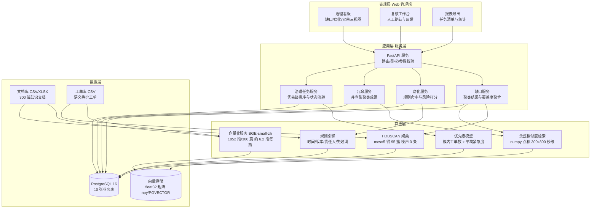

> 用途：放在论文第 3 章「系统总体设计」小节开头，作为全文的总体结构索引图；后续各章的详细设计均可回指本图的某一层。

# 图 3-1 企业知识库质量治理系统四层架构

**图注建议**：图 3-1 给出系统的四层总体架构。表现层提供三视图治理看板、复核工作台与报表导出三类界面；应用层以 FastAPI 为核心，按知识缺口、内容腐化、重复冗余三条业务线拆分服务，并统一由治理任务服务负责优先级排序与状态流转；算法层封装向量化、聚类、相似度检索、规则引擎与优先级模型五个组件；数据层以 PostgreSQL 承载 10 张业务表，并以向量存储承载段落级语义向量。工单数据自下而上驱动缺口识别，文档数据同时驱动腐化识别与冗余识别。

## 各组件职责说明

| 层 | 组件 | 职责 | 关键约束 |
| --- | --- | --- | --- |
| 表现层 | 治理看板 | 并列呈现三类治理任务的 KPI 与明细 | 缺口/腐化/冗余三视图切换 |
| 表现层 | 复核工作台 | 人工确认/驳回治理任务并回写结论 | 复核结论落 audit_log |
| 应用层 | FastAPI 服务 | 统一路由、鉴权、参数校验 | 分页与阈值参数可配 |
| 应用层 | 缺口服务 | 聚合 cluster_result 与覆盖度分位数 | 输出 knowledge_gap |
| 应用层 | 腐化服务 | 执行规则集并累计风险分数 | 风险分数 ≥ 3 判定 |
| 应用层 | 冗余服务 | 对相似度超阈的文档执行并查集成组 | 组级判定 |
| 算法层 | 向量化服务 | 段落级编码并归一化 | BGE-small-zh-v1.5，CPU 可跑 |
| 算法层 | HDBSCAN 聚类 | 对工单向量聚类得到意图簇 | mcs=5，噪声 0 条 |
| 算法层 | 相似度检索 | 工单向量对文档段向量做余弦检索 | 段落最大值聚合 |
| 算法层 | 规则引擎 | 抽取日期、版本、责任人等结构化特征 | 纯规则、可解释 |
| 算法层 | 优先级模型 | 簇规模与紧急度加权排序 | 输出补录优先级 |
| 数据层 | PostgreSQL | 10 张业务表持久化与审计 | 事务一致 |
| 数据层 | 向量存储 | 段落级 float32 向量 | 规模仅千级，无需专用向量库 |