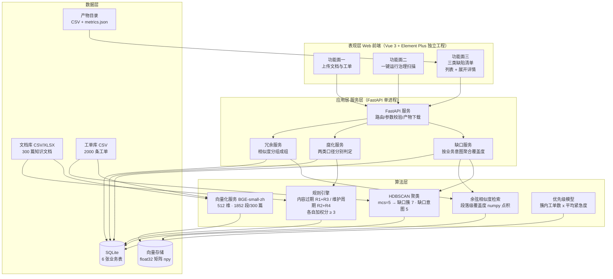

> 用途：放在论文第 3 章「系统总体设计」小节开头，作为全文的总体结构索引图；后续各章的详细设计均可回指本图的某一层。

> **状态：草案，未定稿。** 本图已按现行口径（数据表 6 张 / 向量 512 维 / 段落级与整篇级指标并列）修正，但其中涉及产品形态与 UI 形态的部分仍是**待拍板假设**（见 `docs/技术方案/开发前准备清单.md` §4.11 的 P3/P4/P7），拍板前不进论文定稿。

# 图 3-1 企业知识库质量治理系统四层架构

**图注建议**：图 3-1 给出系统的四层总体架构。表现层为 Vue 3 + Element Plus 前端，承载上传文档与工单、一键运行治理扫描、三类缺陷清单三个功能面，清单以列表加展开详情呈现；应用层以 FastAPI 单进程服务为核心，按知识缺口、内容腐化、重复冗余三条业务线拆分服务，扫描产物以 CSV 形式直接下载；算法层封装向量化、聚类、相似度检索、规则引擎与优先级模型五个组件，向量模型为 BAAI/bge-small-zh-v1.5，输出 512 维向量，HDBSCAN 取 min_cluster_size=5 时判出缺口簇 7 个、缺口意图 5 个；内容腐化由内容过期（R1 + R3）与维护周期（R2 + R4）两类口径各自独立判定、各自加权分达到 3 即判为缺陷，不合成单一 F1；数据层以 SQLite 承载 6 张业务表，并以 np.ndarray 文件承载段落级语义向量。工单数据自下而上驱动缺口识别，文档数据同时驱动腐化识别与冗余识别。

## 各组件职责说明

| 层 | 组件 | 职责 | 关键约束 |
| --- | --- | --- | --- |
| 表现层 | Web 前端 | 承载上传文档与工单、一键运行治理扫描、三类缺陷清单三个功能面 | 清单为列表 + 展开详情，不提供批量处置与阈值调节 |
| 应用层 | FastAPI 服务 | 统一路由、参数校验、产物下载 | 单进程同步接口，无任务队列与外部服务依赖 |
| 应用层 | 缺口服务 | 按业务意图聚合簇覆盖度，意图覆盖度取其下各簇最小值 | 输出 knowledge_gap（意图级） |
| 应用层 | 腐化服务 | 按内容过期、维护周期两类口径分别执行规则并各自累计加权分 | 各自加权分 ≥ 3 判定，两类独立报 P/R/F1 |
| 应用层 | 冗余服务 | 对相似度超阈的文档执行分组 | 组级判定 |
| 算法层 | 向量化服务 | 段落级编码并归一化 | BGE-small-zh-v1.5，512 维，CPU 可跑 |
| 算法层 | HDBSCAN 聚类 | 对工单向量聚类得到意图簇 | mcs=5，缺口簇 7 个、缺口意图 5 个 |
| 算法层 | 相似度检索 | 工单向量对文档段向量做余弦检索 | 段落最大值聚合 |
| 算法层 | 规则引擎 | 抽取日期、版本、责任人等结构化特征 | 纯规则、可解释；内容过期用 R1+R3，维护周期用 R2+R4，两套规则各自加权 |
| 算法层 | 优先级模型 | 簇规模与紧急度加权排序 | 输出补录优先级 |
| 数据层 | SQLite | 6 张业务表持久化 | document / ticket / cluster_result / knowledge_gap / stale_document / duplicate_group |
| 数据层 | 向量存储 | 段落级 float32 向量 | 规模仅千级，无需专用向量库 |

**口径备注**：内容腐化检测按两类缺陷口径分别评估，不合成单一 F1。内容过期（R1 + R3）精确率 1.0000、召回率 1.0000、F1 1.0000；维护周期（R2 + R4）精确率 0.8158、召回率 1.0000、F1 0.8986。合计检出 69 篇，覆盖全部 62 篇埋设缺陷。内容过期口径的满分来自规则与自造语料埋设模板一致，属循环验证，不代表真实语料上的表现；维护周期口径的 7 篇误报中 6 篇来自刻意埋设的「长期未更新但不算缺陷」对照样本、1 篇是重复件继承了主文档的陈旧修改时间，属有意保留的真实边界。缺口模块以业务意图为判定单元，意图覆盖度取该意图下各簇覆盖度的最小值。
