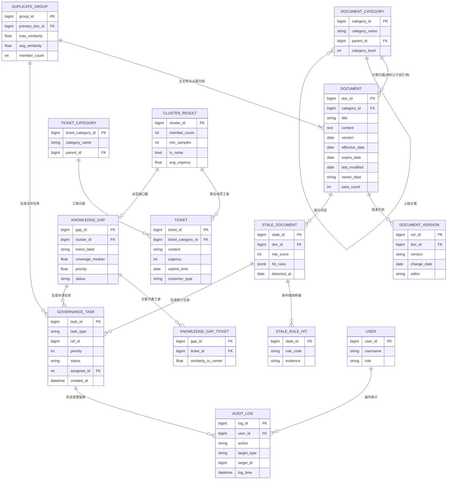

> 用途：放在论文第 4 章「数据库设计」小节，说明 10 张表的实体关系与基数约束，作为表结构设计与接口设计的前置依据。

# 图 4-1 系统数据库 E-R 图

## 主要关系的基数与可选性说明

下表逐条说明 E-R 图中各关系的基数符号含义与业务上的可选性，可直接改写为论文正文的一段文字。

| 关系 | Mermaid 记号 | 基数含义 | 可选性说明 |
| --- | --- | --- | --- |
| document_category → document | `\|\|--o{` | 一个分类拥有 0..N 篇文档，每篇文档**必须**属于且只属于一个分类 | document 的 category_id 非空；分类树通过 parent_id 自引用，根分类 parent_id 为空 |
| document_category → document_category | `\|\|--o{` | 一个分类可有 0..N 个子分类 | 根节点 parent_id 为 NULL，其余非空，level 限定深度 |
| document → document_version | `\|\|--o{` | 一篇文档可有 0..N 条版本记录 | version 表用于追溯「本政策自 2024 年 1 月 1 日起施行」类声明的变更历史 |
| ticket_category → ticket | `\|\|--o{` | 一个工单分类拥有 0..N 条工单 | 工单原始分类来自业务系统，与聚类得到的 intent 簇是两套标签，前者用于工单侧统计，后者用于缺口判定 |
| cluster_result → ticket | `\|\|--o{` | 一个聚类簇聚合 0..N 条工单 | 实测 mcs=5、min_samples=5 时噪声 0 条，故正式簇成员数均 ≥ 5 |
| cluster_result → knowledge_gap | `\|\|--o{ \|--o|` | 一个簇至多对应一条知识缺口记录 | 仅当覆盖度中位数低于阈值时才落 knowledge_gap 行，故为「零或一」 |
| knowledge_gap ↔ ticket | `o{`（中间表） | 缺口与工单多对多 | 通过 knowledge_gap_ticket 记录代表工单及其到簇心的相似度，供人工复核取样 |
| document → stale_document | `\|\|--o{` | 一篇文档可被判定为 0..N 次腐化（每次检测产生一条快照） | 修订后重新检测会新增记录而非覆盖，保留检测历史 |
| stale_document → stale_rule_hit | `\|\|--o{` | 一条腐化记录命中 1..N 条规则 | risk_score ≥ 3 判定为高风险，命中规则明细用于向用户解释判定理由 |
| duplicate_group → document | `\|\|--o{` | 一个冗余组包含 1 主文档 + N 从属文档 | primary_doc_id 必选且必须是组内某一篇；组内相似度需超过阈值 |
| knowledge_gap / stale_document / duplicate_group → governance_task | `\|\|--o{` | 每条治理记录可派生 0..N 条任务 | 任务类型分别为补录、修订、合并；ref_id 为多态外键，由 task_type 决定指向 |
| governance_task → audit_log | `\|\|--o{` | 一条任务的状态变更产生 0..N 条审计日志 | 复核通过/驳回均须留痕 |
| user → audit_log | `\|\|--o{` | 一个用户产生 0..N 条审计日志 | 复核人、审核人均记入 user 表 |

**图注建议**：图 4-1 给出系统数据库的实体关系设计。核心线索是「一条链路贯穿三类治理对象」：document 与 ticket 分别通过分类表完成归属，ticket 经 cluster_result 聚合为意图簇并派生 knowledge_gap；document 一侧派生 stale_document 与 duplicate_group；三类治理记录统一经 governance_task 进入人工复核，所有状态变更由 audit_log 留痕，形成可追溯的治理闭环。

## 表清单速查

前 10 张为业务主干表，后 3 张为明细/关联表（可按实现需要拆出）。

| # | 表名 | 中文名 | 说明 |
| --- | --- | --- | --- |
| 1 | document | 文档表 | 300 篇知识文档，含生效/失效日期与版本 |
| 2 | document_category | 文档分类表 | 树形分类，支持多级归属 |
| 3 | ticket | 工单表 | 客服工单原文与紧急程度 |
| 4 | ticket_category | 工单分类表 | 工单侧分类 |
| 5 | cluster_result | 聚类结果表 | HDBSCAN 簇与噪声标记 |
| 6 | knowledge_gap | 知识缺口表 | 覆盖度不足的意图簇 |
| 7 | stale_document | 腐化文档表 | 规则命中的过期文档 |
| 8 | duplicate_group | 冗余组表 | 高相似文档分组 |
| 9 | governance_task | 治理任务表 | 三类任务的统一出口 |
| 10 | audit_log | 审计日志表 | 复核与操作留痕 |
| 附 | document_version | 文档版本表 | 版本变更历史 |
| 附 | stale_rule_hit | 规则命中明细表 | 解释腐化判定理由 |
| 附 | knowledge_gap_ticket | 缺口-工单关联表 | 记录代表工单到簇心相似度 |