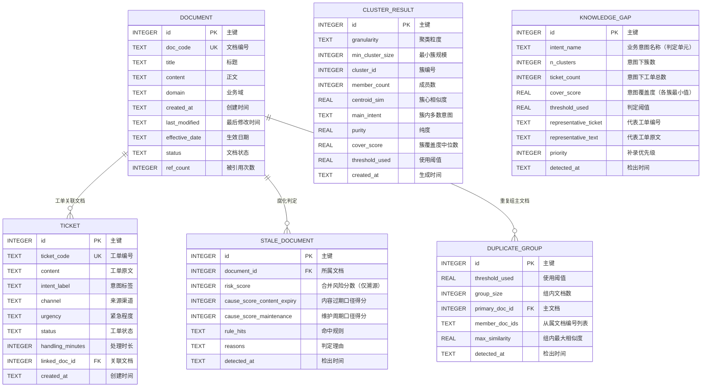

> 用途：放在论文第 4 章「数据库设计」小节，说明 6 张表的实体关系与基数约束，作为表结构设计与接口设计的前置依据。

> **状态：草案，未定稿。** 本图已按现行口径（数据表 6 张 / 向量 512 维 / 段落级与整篇级指标并列）修正，但其中涉及产品形态与 UI 形态的部分仍是**待拍板假设**（见 `docs/技术方案/开发前准备清单.md` §4.11 的 P3/P4/P7），拍板前不进论文定稿。

# 图 4-1 系统数据库 E-R 图

## 主要关系的基数与可选性说明

下表逐条说明 E-R 图中各关系的基数符号含义与业务上的可选性，可直接改写为论文正文的一段文字。

| 关系 | Mermaid 记号 | 基数含义 | 可选性说明 |
| --- | --- | --- | --- |
| document → ticket | `\|\|--o{` | 一篇文档可被 0..N 条工单关联 | ticket.linked_doc_id 允许为空，表示该工单尚无对应文档 |
| document → stale_document | `\|\|--o{` | 一篇文档可被判定为 0..N 次腐化（每次检测产生一条记录） | 内容过期（R1 + R3）与维护周期（R2 + R4）两类口径各自独立判定，各自加权分达到 3 才写入，命中规则与判定理由随记录留存 |
| document → duplicate_group | `\|\|--o{` | 一个重复组包含 1 主文档 + N 从属文档 | primary_doc_id 必选且必须是组内某一篇；组内相似度需超过阈值 |
| cluster_result → knowledge_gap | 不建外键，按 intent_name ↔ main_intent 软链接 | 一个业务意图可由 0..N 个簇组成 | 缺口判定以业务意图为单位：意图覆盖度取该意图下各簇覆盖度的最小值，最小值低于阈值时该意图进入缺口清单；意图与簇的对应靠 `knowledge_gap.intent_name` ↔ `cluster_result.main_intent`，簇级明细留在 cluster_result 供溯源 |
| cluster_result（成员关系） | 不建外键表 | 意图下工单总数记于 knowledge_gap.ticket_count，簇数记于 knowledge_gap.n_clusters | 代表工单记于 representative_ticket / representative_text，缺口判定证据即在此处 |
| ticket（意图标签） | 非外键 | 工单意图由业务侧给定并参与簇内多数投票 | 聚类得到的簇与原有意图标签是两套标签，后者用于工单侧统计 |

**图注建议**：图 4-1 给出系统数据库的实体关系设计。核心线索是「一条链路贯穿三类治理对象」：ticket 经 linked_doc_id 关联 document，工单向量聚类结果落 cluster_result，覆盖度不足时以业务意图为单位派生 knowledge_gap；document 一侧派生 stale_document 与 duplicate_group。工单与文档都是只读输入，治理结论由算法层产出后统一落库，不设用户与审计实体，日期时间统一以 ISO-8601 文本存入 TEXT 列。

## 表清单速查

6 张表即系统的全部持久化对象。

| # | 表名 | 中文名 | 说明 |
| --- | --- | --- | --- |
| 1 | document | 文档表 | 300 篇知识文档，含生效日期、最后修改时间与状态 |
| 2 | ticket | 工单表 | 2000 条工单原文、意图标签与紧急程度 |
| 3 | cluster_result | 聚类结果表 | HDBSCAN 簇、粒度、最小簇规模与使用阈值 |
| 4 | knowledge_gap | 知识缺口表 | 覆盖度不足的业务意图，含意图覆盖度、代表工单与补录优先级 |
| 5 | stale_document | 腐化文档表 | 按内容过期与维护周期两类口径判定的过期文档，含命中规则、风险分数与判定理由 |
| 6 | duplicate_group | 冗余组表 | 高相似文档分组，含主文档与组内最大相似度 |

**口径备注**：内容腐化检测按两类缺陷口径分别评估，不合成单一 F1——内容过期（R1 + R3）精确率 1.0000、召回率 1.0000、F1 1.0000，维护周期（R2 + R4）精确率 0.8158、召回率 1.0000、F1 0.8986；两类语义不同，stale_document 的判定结论按各自口径分别统计，合计层面只讲覆盖面（埋设 62 篇、检出 69 篇、覆盖 62 篇）。内容过期口径的满分来自规则与自造语料埋设模板一致，属循环验证；维护周期口径的 7 篇误报属有意保留的真实边界。缺口侧的判定单元是业务意图，簇级明细只作内部量与溯源，主清单为意图级 5 个缺口意图。
