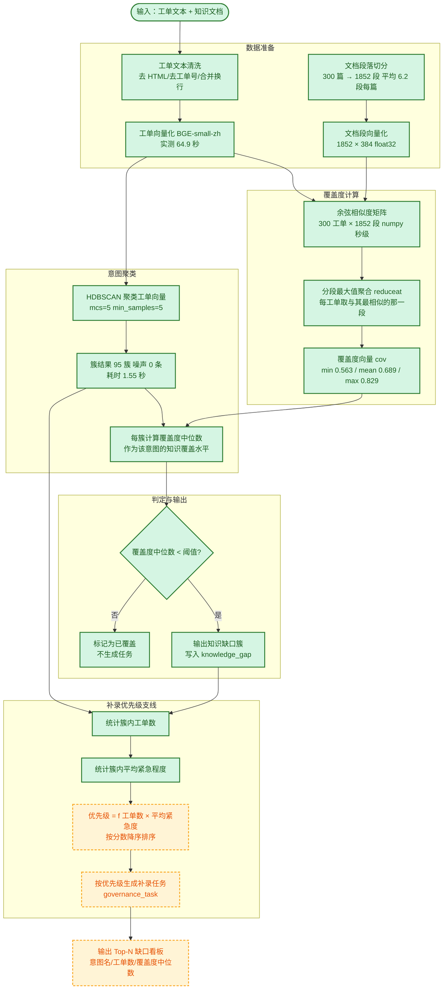

> 用途：放在论文第 5 章「知识缺口识别算法设计」小节，完整呈现从工单入库到缺口簇输出的处理链路，并标注每一步的实测验证状态。

# 图 5-1 知识缺口识别算法流程

## 图例

| 颜色 | 含义 |
| --- | --- |
| 🟩 绿色 | **已实测验证**：脚本已跑通，产出真实指标 |
| 🟨 黄色 | **待实现的设计**：流程已确定，工程尚未落地 |

**图注建议**：图 5-1 给出知识缺口识别的完整算法流程。流程以工单文本与知识文档为输入，先分别完成段落切分与向量化，再计算工单向量与文档段向量的余弦相似度矩阵；矩阵沿段落维度取最大值聚合，得到每条工单的覆盖度（实测 min=0.563、mean=0.689、max=0.829），使「一条工单是否被知识库覆盖」成为可比标量。随后对工单向量执行 HDBSCAN 聚类（mcs=5，得 95 簇、噪声 0 条、耗时 1.55 秒），并以簇内覆盖度中位数作为该意图的覆盖水平，与阈值比较后判定缺口。图右侧为优先级支线，按「簇内工单数 × 平均紧急程度」排序决定补录次序。绿色实线为已实测验证环节，黄色虚线为待实现的设计环节。

## 各步骤实测数据

| 步骤 | 实测值 | 说明 |
| --- | --- | --- |
| 数据生成 | 1.1 s | 合成工单与文档并注入已知缺陷 |
| 文档段落切分 | 1852 段 / 300 篇 | 平均 6.2 段/篇 |
| 向量化 | 64.9 s | 全部工单与文档段完成编码 |
| 检测（三模块合计） | 3.7 s | 含余弦矩阵、聚类、规则、并查集 |
| 全链路 | 109 s | 1.1 + 64.9 + 3.7 及其余开销 |
| 余弦矩阵 | 300 × 1852 | numpy 点积秒级完成 |
| HDBSCAN | 95 簇 / 噪声 0 条 / 1.55 s | mcs=5 |
| 覆盖度 | min 0.563 / mean 0.689 / max 0.829 | 分段最大值聚合 |
| 缺口识别 F1 | 0.800 | 段落级判定 |
| 段落级 vs 整篇级 AUC | 0.968 vs 0.936 | 段落级更优 |
| CPU 吞吐 | 123 条/秒 | 全 CPU，无 GPU 参与 |