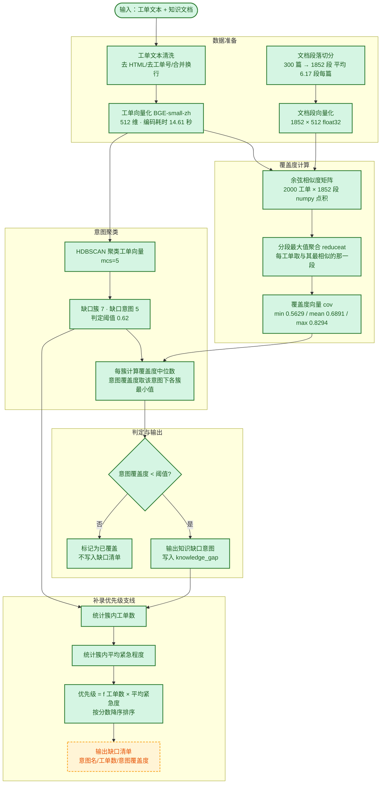

> 用途：放在论文第 5 章「知识缺口识别算法设计」小节，完整呈现从工单入库到缺口簇输出的处理链路，并标注每一步的实测验证状态。

> **状态：草案，未定稿。** 本图已按现行口径（数据表 6 张 / 向量 512 维 / 段落级与整篇级指标并列）修正，但其中涉及产品形态与 UI 形态的部分仍是**待拍板假设**（见 `docs/技术方案/开发前准备清单.md` §4.11 的 P3/P4/P7），拍板前不进论文定稿。

# 图 5-1 知识缺口识别算法流程

## 图例

| 颜色 | 含义 |
| --- | --- |
| 🟩 绿色 | **已实测验证**：脚本已跑通，产出真实指标 |
| 🟨 黄色 | **待实现的设计**：流程已确定，工程尚未落地 |

**图注建议**：图 5-1 给出知识缺口识别的完整算法流程。流程以工单文本与知识文档为输入，先分别完成段落切分与向量化（512 维，实测编码耗时 14.61 秒），再计算工单向量与文档段向量的余弦相似度矩阵；矩阵沿段落维度取最大值聚合，得到每条工单的覆盖度（实测 min=0.5629、mean=0.6891、max=0.8294），使「一条工单是否被知识库覆盖」成为可比标量。随后对工单向量执行 HDBSCAN 聚类（min_cluster_size=5），取阈值 0.62 判定后得到缺口簇 7 个、缺口意图 5 个，缺口识别 P/R/F1 = 0.800/0.800/0.800。缺口判定以业务意图为单位，意图覆盖度取该意图下各簇覆盖度的最小值，簇级明细只作内部量与溯源。右列为优先级支线，按「簇内工单数 × 平均紧急程度」排序决定补录次序。绿色实线为已实测验证环节，黄色虚线为待实现的设计环节。

## 各步骤实测数据

| 步骤 | 实测值 | 说明 |
| --- | --- | --- |
| 文档段落切分 | 1852 段 / 300 篇 | 平均 6.17 段/篇 |
| 向量化 | 14.61 秒 | 4152 条文本（300 篇文档 + 2000 条工单 + 1852 段）；耗时跨机器波动，以当前产物为准 |
| 三模块检测合计 | 3.46 秒 | 耗时跨机器波动，以当前产物为准 |
| 其中：腐化检测 | 0.45 秒 | 耗时跨机器波动，以当前产物为准 |
| 其中：重复检测 | 0.0 秒 | 300 × 300 余弦矩阵；耗时跨机器波动，以当前产物为准 |
| 余弦矩阵 | 2000 × 1852 | numpy 点积 |
| 缺口判定 | mcs=5 · 阈值 0.62 | 缺口簇 7 · 缺口意图 5 |
| 覆盖度 | min 0.5629 / mean 0.6891 / max 0.8294 | 分段最大值聚合 |
| 缺口识别 F1 | 0.800 | 段落级判定；判定单元为业务意图，检出 5 个意图（对应 7 个缺口簇） |
| 段落级 vs 整篇级 AUC | 0.968 vs 0.8880 | 意图级，段落级更优 |
| 内容过期口径 P/R/F1 | 1.0000 / 1.0000 / 1.0000 | R1 + R3；真值 32 篇 / 检出 32 篇 / TP 32 / FP 0 / FN 0 |
| 维护周期口径 P/R/F1 | 0.8158 / 1.0000 / 0.8986 | R2 + R4；真值 31 篇 / 检出 38 篇 / TP 31 / FP 7 / FN 0 |
| 腐化检出合计 | 埋 62 篇 / 检出 69 篇 / 覆盖 62 篇 | 两类口径合并只作覆盖面说明，不合成单一 F1；7 篇误报全部属维护周期口径 |
| 重复识别 F1 | 0.95 阈值组级 1.0 | 0.90 阈值下组级 F1 0.7037 |

**口径备注**：内容腐化检测按两类缺陷口径分别评估。内容过期（R1 + R3）精确率 1.0000、召回率 1.0000、F1 1.0000；维护周期（R2 + R4）精确率 0.8158、召回率 1.0000、F1 0.8986；两类语义不同，各自单独报告。内容过期口径的满分来自规则与生成器埋设模板一致，属自造语料上的循环验证，不代表真实语料上的表现；维护周期口径的 7 篇误报中，6 篇来自刻意埋设的「长期未更新但不算缺陷」对照样本，1 篇是重复件继承了主文档的陈旧修改时间，与真缺陷的规则命中完全相同，属有意保留的真实边界。
