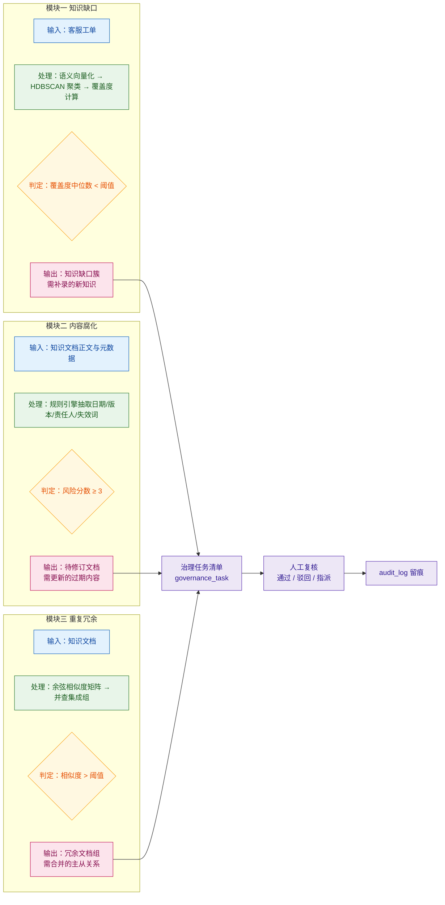

> 用途：放在论文第 5 章末尾或第 6 章开头，作为「内容腐化」「重复冗余」两模块与「知识缺口」模块的横向对照，突出三者统一治理出口的设计。

# 图 5-2 三个治理模块的输入-处理-输出-判定对照

**图注建议**：图 5-2 对三个治理模块进行横向对照。三者的输入侧不同——知识缺口面向工单流，内容腐化与重复冗余面向文档流；处理侧分别采用「聚类 + 覆盖度」「规则引擎」「余弦矩阵 + 并查集」三条互不依赖的技术路线；判定条件分别为覆盖度中位数低于阈值、风险分数达到 3、相似度超过阈值。三条路线的产出最终汇入统一的治理任务清单，经人工复核后写入审计日志，形成一致的运维闭环。

## 三模块参数与指标对照表

| 维度 | 知识缺口 | 内容腐化 | 重复冗余 |
| --- | --- | --- | --- |
| 输入对象 | 客服工单 | 知识文档正文与元数据 | 知识文档 |
| 输入规模（实测） | 300 条工单 | 300 篇文档 | 300 篇文档 |
| 核心技术 | BGE-small-zh 向量化 + HDBSCAN 聚类 + 覆盖度 | 规则引擎（日期/版本/责任人/失效词） | 段落级余弦矩阵 + 并查集 |
| 核心中间量 | 覆盖度 cov 与其簇内中位数 | 风险分数 risk_score | 相似度 sim |
| 判定条件 | 簇内覆盖度中位数 < 阈值 | risk_score ≥ 3 | sim > 阈值 |
| 实测关键参数 | mcs=5，95 簇，噪声 0 条 | 风险阈值 3 | 阈值 0.95 |
| 输出实体 | knowledge_gap | stale_document | duplicate_group |
| 输出粒度 | 意图簇（一簇一缺口） | 单篇文档 | 文档组（1 主 + N 从） |
| 生成任务类型 | 补录 | 修订 | 合并 |
| 实测 F1 | 0.800 | 0.9466 | 0.95 阈值下组级 1.0；0.90 阈值下 0.7037 |
| 可解释性来源 | 覆盖度中位数与簇内代表工单 | 命中规则明细与证据文本 | 组内两两相似度与主从文档对 |

## 三模块差异的设计动机

- **知识缺口**是唯一需要跨语义空间匹配的模块：缺口不存在于文档中，只能通过「工单问的问题与所有文档段的最大相似度」间接推断，因此必须先聚类再取中位数，抑制单条工单表述差异带来的噪声。
- **内容腐化**刻意不使用模型：过期事实是显式时间声明，规则引擎准确率已达 F1=0.9466，且可向业务方逐条解释「命中了哪条规则、证据是哪句话」，这比模型精度更重要。
- **重复冗余**只需判断「是否讲同一件事」，相似度矩阵配合并查集即可把传递性相似聚成组；但阈值敏感（0.95 与 0.90 之间 F1 由 1.0 掉到 0.7037），因此保留人工指定主文档的入口。