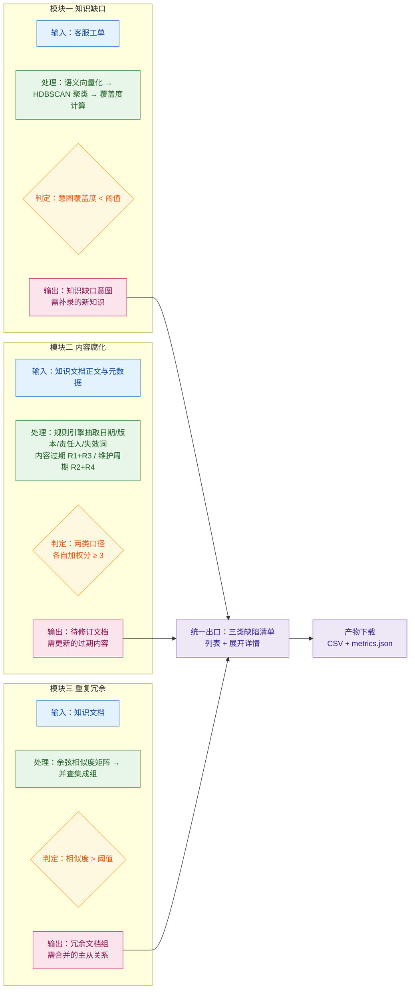

> 用途：放在论文第 5 章末尾或第 6 章开头，作为「内容腐化」「重复冗余」两模块与「知识缺口」模块的横向对照，突出三者统一治理出口的设计。

> **状态：草案，未定稿。** 本图已按现行口径（数据表 6 张 / 向量 512 维 / 段落级与整篇级指标并列）修正，但其中涉及产品形态与 UI 形态的部分仍是**待拍板假设**（见 `docs/技术方案/开发前准备清单.md` §4.11 的 P3/P4/P7），拍板前不进论文定稿。

# 图 5-2 三个治理模块的输入-处理-输出-判定对照

**图注建议**：图 5-2 对三个治理模块进行横向对照。三者的输入侧不同——知识缺口面向工单流，内容腐化与重复冗余面向文档流；处理侧分别采用「聚类 + 覆盖度」「规则引擎」「余弦矩阵 + 并查集」三条互不依赖的技术路线；判定条件分别为意图覆盖度低于阈值、内容过期与维护周期两类口径各自加权分达到 3、相似度超过阈值。三条路线的产出统一汇入三类缺陷清单，以列表加展开详情呈现，并直接提供产物 CSV 下载，判定结论与支撑证据一一对应。

## 三模块参数与指标对照表

| 维度 | 知识缺口 | 内容腐化 | 重复冗余 |
| --- | --- | --- | --- |
| 输入对象 | 客服工单 | 知识文档正文与元数据 | 知识文档 |
| 输入规模（实测） | 2000 条工单 | 300 篇文档 | 300 篇文档 |
| 核心技术 | BGE-small-zh 向量化 + HDBSCAN 聚类 + 覆盖度 | 规则引擎（日期/版本/责任人/失效词） | 段落级余弦矩阵 + 并查集 |
| 核心中间量 | 覆盖度 cov 与其簇内中位数 | 两类口径的加权分（内容过期 R1+R3 / 维护周期 R2+R4） | 相似度 sim |
| 判定条件 | 意图覆盖度 < 阈值 | 两类口径各自加权分 ≥ 3 | sim > 阈值 |
| 实测关键参数 | mcs=5，阈值 0.62，缺口簇 7、缺口意图 5 | 两类口径阈值各为 3 | 阈值 0.95 |
| 输出实体 | knowledge_gap | stale_document | duplicate_group |
| 输出粒度 | 业务意图（一意图一缺口） | 单篇文档（两类口径各自判定） | 文档组（1 主 + N 从） |
| 处置方向 | 补录 | 修订 | 合并 |
| 实测 F1 | 0.800 | 内容过期 1.0000；维护周期 0.8986 | 0.95 阈值下组级 1.0；0.90 阈值下 0.7037 |
| 可解释性来源 | 覆盖度中位数与簇内代表工单 | 命中规则明细与证据文本 | 组内两两相似度与主从文档对 |

## 三模块差异的设计动机

- **知识缺口**是唯一需要跨语义空间匹配的模块：缺口不存在于文档中，只能通过「工单问的问题与所有文档段的最大相似度」间接推断，因此必须先聚类再取中位数，抑制单条工单表述差异带来的噪声。
- **内容腐化**刻意不使用模型：过期事实是显式时间声明，规则引擎可向业务方逐条解释「命中了哪条规则、证据是哪句话」，这比模型精度更重要；但两类缺陷语义不同，不能混算成一个 F1。内容过期（R1 + R3）精确率 1.0000、召回率 1.0000、F1 1.0000；维护周期（R2 + R4）精确率 0.8158、召回率 1.0000、F1 0.8986。内容过期口径的满分来自规则与自造语料埋设模板一致，属循环验证；维护周期口径的 7 篇误报与真缺陷的规则命中完全相同，属有意保留的真实边界。
- **重复冗余**只需判断「是否讲同一件事」，相似度矩阵配合并查集即可把传递性相似聚成组；但阈值敏感（0.95 与 0.90 之间组级 F1 由 1.0 掉到 0.7037），因此把 0.95 固定为判定阈值，并在论文中同时给出 0.90 阈值下的真实预期基线。

**口径备注**：内容腐化检测按两类缺陷口径分别评估，不合成单一 F1。合计层面只讲覆盖面：埋设 62 篇、检出 69 篇、覆盖全部 62 篇；7 篇误报全部属维护周期口径，内容过期口径误报为 0。缺口模块的判定单元为业务意图，意图覆盖度取该意图下各簇覆盖度的最小值。
