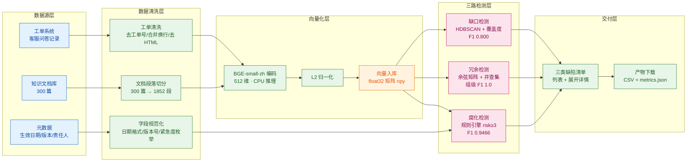

> 用途：放在论文第 6 章「系统实现」或第 3 章末尾，完整展示从数据采集到三类缺陷清单交付的全链路数据流，清单与产物下载部分是系统卖点所在。

> **状态：草案，未定稿。** 本图已按现行口径（数据表 6 张 / 向量 512 维 / 段落级与整篇级指标并列）修正，但其中涉及产品形态与 UI 形态的部分仍是**待拍板假设**（见 `docs/技术方案/开发前准备清单.md` §4.11 的 P3/P4/P7），拍板前不进论文定稿。

# 图 6-1 全链路数据流与治理闭环

**图注建议**：图 6-1 展示系统的全链路数据流。左侧为数据源（工单系统、知识文档库、文档元数据），经数据清洗与段落切分后由 BGE-small-zh 完成 512 维编码并归一化入库；中部三路检测平行展开，分别以聚类覆盖度、规则引擎、相似度并查集产出三类治理结论（F1 分别为 0.800、0.9466、组级 1.0）；右侧统一汇入三类缺陷清单，以列表加展开详情呈现，并直接提供产物 CSV 与 metrics.json 下载，使判定结论、支撑证据与可复现指标在同一链路内闭合。

## 清单可交付的三个前提

| 前提 | 说明 | 本系统如何满足 |
| --- | --- | --- |
| 结论可验证 | 机器判定必须能被人工验证 | 每条治理记录都携带证据：缺口带覆盖度与代表工单，腐化带命中规则与证据句，冗余带组内相似度与主从文档对 |
| 结论可获取 | 结论必须以可下载的形态交付 | 扫描产物以 CSV 落盘，清单页直接下载 top15_gaps.csv / corrupt_docs.csv / dup_groups_best.csv 与 metrics.json |
| 重跑成本可接受 | 重新扫描须在分钟级完成 | 向量化实测 14.61 秒、三模块检测合计 3.09 秒，耗时跨机器波动，以当前产物为准 |

## 全链路耗时分解

| 阶段 | 耗时 | 说明 |
| --- | --- | --- |
| 语义向量化 | 14.61 秒 | 4152 条文本（300 篇文档 + 2000 条工单 + 1852 段）；耗时跨机器波动，以当前产物为准 |
| 三模块检测合计 | 3.09 秒 | 缺口 + 腐化 + 重复；耗时跨机器波动，以当前产物为准 |
| 其中：腐化检测 | 0.4 秒 | 耗时跨机器波动，以当前产物为准 |
| 其中：重复检测 | 0.0 秒 | 300 × 300 余弦矩阵；耗时跨机器波动，以当前产物为准 |

结论：耗时集中在向量化，而向量化结果是可缓存复用的（同一批文档段向量在缺口检测、冗余检测、阈值扫描、消融实验中反复使用），因此重新扫描的实际成本远低于重复编码。
