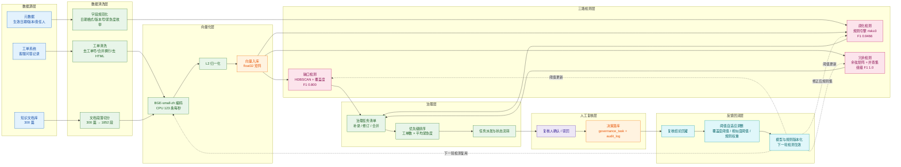

> 用途：放在论文第 6 章「系统实现」或第 3 章末尾，完整展示从数据采集到治理闭环的全链路数据流，闭环部分是系统卖点所在。

# 图 6-1 全链路数据流与治理闭环

**图注建议**：图 6-1 展示系统的全链路数据流与治理闭环。左侧为数据源（工单系统、知识文档库、文档元数据），经数据清洗与段落切分后由 BGE-small-zh 完成编码并归一化入库；中部三路检测平行展开，分别以聚类覆盖度、规则引擎、相似度并查集产出三类治理结论，并统一汇入治理任务清单；右侧为人工复核与决策落库。底部的反馈回流是本系统的核心设计：复核人的通过/驳回结论回灌后，会自适应调整覆盖度阈值、相似度阈值与规则权重，并将调整后的模型与规则版本化，使下一轮检测直接复用，从而把「一次性检出」升级为「可持续收敛」的治理闭环。

## 闭环成立的三个前提

| 前提 | 说明 | 本系统如何满足 |
| --- | --- | --- |
| 结论可复核 | 机器判定必须能被人工验证 | 每条治理记录都携带证据：缺口带覆盖度与代表工单，腐化带命中规则与证据句，冗余带组内相似度矩阵 |
| 反馈可量化 | 复核结论须能翻译成参数调整量 | 复核结果按「真缺口/假缺口」「真过期/假过期」「真冗余/假冗余」分类，直接映射到阈值与规则权重的调整 |
| 重跑成本可接受 | 反馈生效要求能快速重跑全链路 | 全链路实测 109 秒，其中检测仅 3.7 秒，反馈到验证的循环在分钟级完成 |

## 全链路耗时分解

| 阶段 | 耗时 | 占比 |
| --- | --- | --- |
| 数据生成与清洗 | 1.1 s | 约 1% |
| 向量化 | 64.9 s | 约 60% |
| 三模块检测 | 3.7 s | 约 3% |
| 其余 I/O 与统计 | 其余 | 其余 |
| 合计 | 109 s | 100% |

结论：耗时集中在向量化，而向量化结果是可缓存复用的（同一批文档段向量在缺口检测、冗余检测、阈值扫描、消融实验中反复使用），因此反馈闭环的实际迭代成本远低于 109 秒。