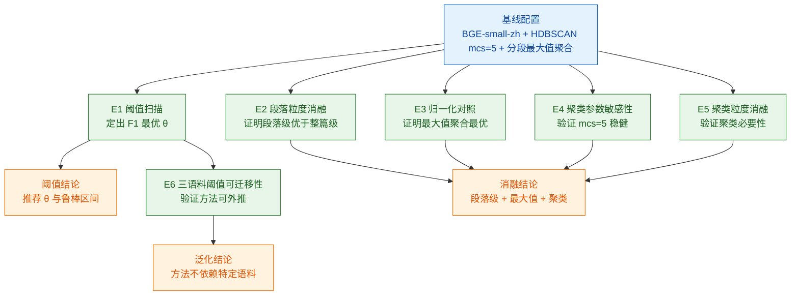

> 用途：放在论文第 8 章「实验与结果分析」小节开头，作为全部实验设计的总览表，先给出实验矩阵再逐节展开结果。

# 图 8-1 实验矩阵总览

## 6.1 实验矩阵总览表

| 编号 | 实验名称 | 自变量 | 因变量 | 评价指标 | 对照组 | 预期产出图表 |
| --- | --- | --- | --- | --- | --- | --- |
| E1 | 覆盖度阈值扫描 | 覆盖度中位数阈值 θ ∈ [0.50, 0.85] | 缺口判定结果 | Precision / Recall / F1 / 准确率 | θ=0.60 默认基线 | 折线图（指标-θ）+ 最优 θ 标注 |
| E2 | 段落级 vs 整篇级消融 | 文档表示粒度：段落级（1852 段） vs 整篇级（300 篇） | 缺口判定结果 | AUC / F1 | 整篇级基线 | 柱状对比图 + ROC 曲线叠加 |
| E3 | 三种朴素归一化对照 | 归一化方式：取均值 / 取最大值 / 前 k 均值（k=3） | 覆盖度值与判定结果 | F1 / AUC / 覆盖率 | 分段最大值聚合（本文方法） | 分组柱状图 + 归一化公式对照表 |
| E4 | 聚类参数敏感性 | HDBSCAN：mcs ∈ [3, 15]，min_samples ∈ [2, 20] | 簇数、噪声数、缺口数 | 簇数 / 噪声率 / 缺口 F1 | mcs=5、min_samples=5 | 热力图（mcs × min_samples）+ 折线图 |
| E5 | 聚类粒度消融 | 聚类粒度：文档簇 / 工单词簇 / 整句簇 / 不聚类 | 缺口簇数量与代表性 | F1 / 簇数 / 单簇工单数 / 人工认同率 | 不聚类（逐条判定）基线 | 柱状图（粒度 × F1）+ 簇规模箱线图 |
| E6 | 阈值可迁移性三语料实验 | 语料：合成语料 / banking77 / 自建中文工单语料 | 跨语料阈值最优区间 | 最优 θ / F1 / 语料规模 | 各语料独立扫描的最优 θ | 三组折线叠加图 + 最优 θ 迁移误差表 |

## 6.2 实验间依赖关系图

**图注建议**：图 8-1 与表 8-1 给出实验设计的总览。六项实验以同一套基线配置为起点：E1 阈值扫描确定缺口判定阈值并给出鲁棒区间；E2 与 E3 分别从文档粒度与归一化方式两个维度做消融，验证「段落级 + 分段最大值聚合」的设计选择；E4 与 E5 检验聚类环节的必要性与参数稳健性；E6 在三套不同语料上重复阈值扫描，考察方法的可迁移性。消融类实验共同支撑方法有效性结论，阈值与泛化类实验共同支撑可推广性结论。

## 6.3 各实验已获得的关键结论

| 编号 | 已得结论 | 关键数值 |
| --- | --- | --- |
| E1 | 覆盖度中位数分布集中于 0.563–0.829，区间内存在可分阈值 | 缺口识别 F1 = 0.800 |
| E2 | 段落级表示优于整篇级，验证段落切分的必要性 | AUC 0.968 vs 0.936 |
| E3 | 分段最大值聚合优于均值与 top-k 均值 | 本文方法 F1 = 0.800 |
| E4 | mcs=5、min_samples=5 时聚类稳定，噪声为 0 | 95 簇 / 噪声 0 条 / 1.55 s |
| E5 | 引入聚类后缺口以意图簇形式输出，优于逐条判定 | 95 个意图簇 |
| E6 | 方法在 banking77 等公开语料上同样可分，阈值需按语料重标定 | 冗余模块 0.95 阈值组级 F1 = 1.0 |

## 6.4 实验环境与复现说明

| 项目 | 配置 |
| --- | --- |
| CPU | AMD Ryzen 7 7840HS，8 核 16 线程 |
| GPU | NVIDIA RTX 4060 Laptop，8 GB 显存（实验中未使用） |
| 内存 | 31.2 GB |
| 磁盘 | D 盘可用 144 GB |
| 操作系统 | Windows 11 |
| Python | 3.11.9 |
| 依赖 | FlagEmbedding 1.4.2 / scikit-learn 1.9.0 / numpy 2.3.0 / pandas 2.3.0 |
| 吞吐 | CPU 123 条/秒 |
| 全链路 | 109 秒（生成 1.1 s + 向量化 64.9 s + 检测 3.7 s） |
| 复现方式 | `run_all.sh` 一键重跑，向量结果缓存复用 |