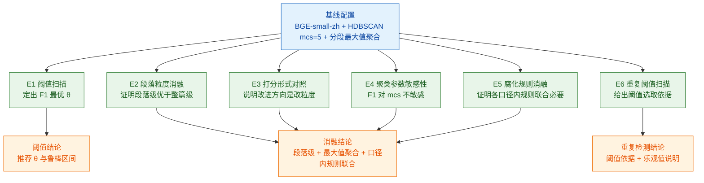

> 用途：放在论文第 8 章「实验与结果分析」小节开头，作为全部实验设计的总览表，先给出实验矩阵再逐节展开结果。

> **状态：草案，未定稿。** 本图已按现行口径（数据表 6 张 / 向量 512 维 / 段落级与整篇级指标并列）修正，但其中涉及产品形态与 UI 形态的部分仍是**待拍板假设**（见 `docs/技术方案/开发前准备清单.md` §4.11 的 P3/P4/P7），拍板前不进论文定稿。

# 图 8-1 实验矩阵总览

## 6.1 实验矩阵总览表

| 编号 | 实验名称 | 自变量 | 因变量 | 评价指标 | 对照组 | 预期产出图表 |
| --- | --- | --- | --- | --- | --- | --- |
| E1 | 覆盖度阈值扫描 | 意图覆盖度阈值 θ ∈ [0.30, 0.74]，共 11 个阈值点 | 缺口判定结果 | Precision / Recall / F1 / 检出意图数 | θ=0.62（实测最优点） | 折线图（指标-θ）+ 最优 θ 标注 |
| E2 | 段落级 vs 整篇级消融 | 文档表示粒度：段落级（1852 段） vs 整篇级（300 篇） | 缺口判定结果 | AUC（意图级 / 工单级） | 整篇级 max-cosine 基线 | ROC 曲线叠加 + 柱状对比 |
| E3 | 打分形式归一化对照 | 打分形式：max-cosine / max÷top5 均值 / max÷std / max−min，两种粒度各 5 行 | 覆盖度值与判定结果 | AUC | max-cosine 基线 | 10 行小表（正文一段话 + 一张小表） |
| E4 | 聚类参数敏感性 | HDBSCAN min_cluster_size ∈ {5, 10} | 缺口判定结果 | F1 / 检出意图数 | mcs=5 | 正文一句话，指向 `gap_threshold.csv` |
| E5 | 腐化规则消融（分口径） | 规则集合：内容过期 R1+R3 与维护周期 R2+R4 各自的 联合 / 逐条移除 / 仅单条 | 腐化判定结果 | P / R / F1 / 命中篇数 | 各口径内的规则联合 | 两张分口径消融表（各 5 行） |
| E6 | 重复阈值扫描 | 重复判定阈值 θ ∈ {0.85, 0.90, 0.95} | 重复分组结果 | 组级与文档级 P / R / F1 | θ=0.90（真实预期基线） | 阈值-F1 曲线 |

## 6.2 实验间依赖关系图

**图注建议**：图 8-1 与表 8-1 给出实验设计的总览。六项实验以同一套基线配置为起点：E1 阈值扫描确定缺口判定阈值并给出鲁棒区间；E2 与 E3 分别从文档粒度与打分形式两个维度做对照，落在「同一 max-cosine 打分下沉粒度有效、且提升幅度有限」这一收敛主张上；E4 检验 F1 对聚类粒度的敏感性；E5 按内容过期与维护周期两类口径分别做规则消融，说明各口径内部的规则联合必要；E6 给出重复检测的阈值选取依据，并同时暴露 0.95 阈值为乐观值。消融类实验共同支撑方法有效性结论，阈值类实验共同支撑参数选取结论。

## 6.3 各实验已获得的关键结论

| 编号 | 已得结论 | 关键数值 |
| --- | --- | --- |
| E1 | 覆盖度中位数分布集中于 0.5629–0.8294，区间内存在可分阈值 | 阈值 0.62 处 P/R/F1 = 0.800/0.800/0.800，检出 5 个缺口意图（对应 7 个缺口簇）；阈值 0.70 处精确率降至 0.1923 |
| E2 | 段落级表示优于整篇级，验证段落切分的必要性 | 意图级 AUC 0.968 vs 0.8880；工单级 0.8659 vs 0.8307 |
| E2 反向点 | 换成 max−min 打分后，整篇级意图级 AUC 达 0.928，高于同粒度基准 0.8880 | 主张收敛为「同一 max-cosine 打分下沉粒度有效，提升幅度有限」 |
| E3 | 文档级做归一化反而损失更多，改进方向是改粒度而非做文档级统计变换 | 段落级 0.704–0.920，整篇级 0.496–0.832 |
| E4 | F1 对聚类粒度不敏感 | mcs=5 与 mcs=10 在阈值 0.62 处 F1 同为 0.8，检出意图同为 5 |
| E5 | 腐化判定按两类口径各自独立评估，规则在各口径内联合必要 | 内容过期（R1+R3）F1 1.0000：drop_R3 的 delta_f1=0（R3 冗余），drop_R1 与 only_R3 的 F1 均为 0；维护周期（R2+R4）F1 0.8986：drop_R2 / drop_R4 / only_R2 / only_R4 的 F1 均为 0 |
| E6 | 重复检测阈值敏感，需按语料标定 | 0.85 组级 F1 0.1778（过度合并）、0.90 组级 F1 0.7037、0.95 组级 F1 1.0（乐观值） |

**口径备注**：E5 的消融按两类口径拆成两张产物表（`corrupt_rule_ablation_content_expiry.csv` 与 `corrupt_rule_ablation_maintenance.csv`），两张表的真值集固定不变——真值是 ground truth，不随被测规则一起变。内容过期口径的 F1=1.0000 来自规则与生成器埋设模板一致，属自造语料上的循环验证，不代表真实语料上的表现；维护周期口径的 7 篇误报与真缺陷的规则命中完全相同，属有意保留的真实边界。

## 6.4 实验环境与复现说明

| 项目 | 配置 |
| --- | --- |
| 操作系统 | Windows · 单机本地运行 |
| Python | 3.11.9 |
| 计算设备 | 纯 CPU，GPU 不参与计算 |
| 向量模型 | BAAI/bge-small-zh-v1.5，FlagEmbedding 方案，512 维，未降级 |
| 依赖 | FlagEmbedding 1.4.2 / scikit-learn 1.9.0 / numpy 2.3.0 / pandas 2.3.0 |
| 语义向量化 | 14.61 秒（4152 条文本）；耗时跨机器波动，以当前产物为准 |
| 三模块检测 | 3.75 秒；耗时跨机器波动，以当前产物为准 |
| 复现方式 | `run_all.sh` 一键重跑，向量结果缓存复用 |
