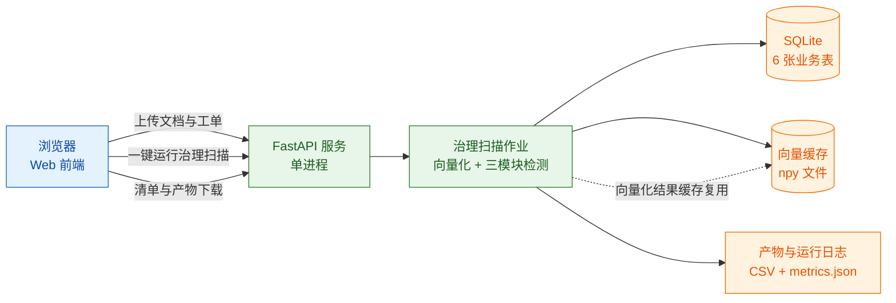

> 用途：放在论文第 7 章「系统部署与运行环境」小节，给出开发机配置、依赖清单，并用实测数据论证「不需要 GPU / 不需要 LLM / 不需要向量数据库」三个工程取舍。

> **状态：草案，未定稿。** 本图已按现行口径（数据表 6 张 / 向量 512 维 / 段落级与整篇级指标并列）修正，但其中涉及产品形态与 UI 形态的部分仍是**待拍板假设**（见 `docs/技术方案/开发前准备清单.md` §4.11 的 P3/P4/P7），拍板前不进论文定稿。

# 图 7-1 系统开发与运行环境

## 7.1 开发机硬件配置

| 项目 | 配置 | 说明 |
| --- | --- | --- |
| 操作系统 | Windows · 单机本地运行 | 开发与实验环境，系统以本地单机形态部署 |
| Python | 3.11.9 | 运行时 |
| 计算设备 | 纯 CPU，GPU 不参与计算 | 向量化、聚类与稠密点积由 numpy / scikit-learn 的 CPU 实现承担 |
| 向量模型 | BAAI/bge-small-zh-v1.5 · 512 维 · 权重 95.8 MB | FlagEmbedding 方案，模型未降级 |
| 数据规模 | 300 篇文档 / 2000 条工单 / 1852 个段落 | 段落向量为 1852 × 512 的 float32 矩阵，内存占用可忽略 |

## 7.2 软件依赖清单

| 依赖 | 版本 | 用途 | 是否必需 |
| --- | --- | --- | --- |
| FlagEmbedding | 1.4.2 | 加载与调用 BGE-small-zh-v1.5 文本编码器 | 必需 |
| scikit-learn | 1.9.0 | HDBSCAN 聚类、评价指标 | 必需 |
| numpy | 2.3.0 | 余弦相似度矩阵、reduceat 聚合 | 必需 |
| pandas | 2.3.0 | 数据读取与结果整理 | 必需 |
| torch | 随 FlagEmbedding 依赖 | CPU 推理后端 | 必需 |
| SQLite | Python 标准库 sqlite3 | 6 张业务表持久化 | 必需 |
| FastAPI | — | Web 服务层 | 必需 |
| 向量数据库 | 无 | 不引入 | **不需要**，理由见 7.4 |
| LLM 服务 | 无 | 不引入 | **不需要**，理由见 7.4 |

## 7.3 性能实测数据

| 指标 | 实测值 | 说明 |
| --- | --- | --- |
| 语义向量化耗时 | 14.61 秒 | 4152 条文本（300 篇文档 + 2000 条工单 + 1852 段）；耗时跨机器波动，以当前产物为准 |
| 三模块检测合计 | 3.46 秒 | 缺口 + 腐化 + 重复；耗时跨机器波动，以当前产物为准 |
| 其中：腐化检测 | 0.45 秒 | 耗时跨机器波动，以当前产物为准 |
| 其中：重复检测 | 0.0 秒 | 300 × 300 余弦矩阵；耗时跨机器波动，以当前产物为准 |
| 文档段落规模 | 1852 段 / 300 篇 | 平均 6.17 段/篇 |
| 覆盖度检索矩阵 | 2000 × 1852 | numpy 矩阵点积 |
| 覆盖度分布 | min 0.5629 / mean 0.6891 / max 0.8294 | 分段最大值聚合 |
| 聚类判定 | mcs=5 · 阈值 0.62 | 缺口簇 7 · 缺口意图 5 |
| 三模块 F1 | 缺口 0.800 / 腐化 内容过期 1.0000、维护周期 0.8986 / 冗余 0.95 阈值组级 1.0 | 冗余 0.90 阈值下降至 0.7037 |
| 段落级 AUC | 0.968（整篇级 0.8880） | 意图级，段落级更优 |

## 7.4 三项「不需要」的工程论证

### （1）不需要 GPU

**论据**：本系统全部算法均由「向量编码 + 稠密点积 + 传统机器学习」三部分构成。

- 编码环节：使用 BGE-small-zh-v1.5（权重 95.8 MB 的小模型）而非任何生成式模型。全量 300 篇文档切分为 1852 段，加上 2000 条工单，向量化阶段实测 14.61 秒，检测阶段实测 3.46 秒。
- 相似度计算：2000 × 1852 的余弦相似度矩阵由 numpy 一次矩阵点积完成；即便语料扩大到 2000 篇文档（设计值，尚未实测），也只是同一量级的浮点运算，仍在秒级完成，远未触及 CPU 的算力边界。
- 聚类与规则：HDBSCAN 作用于 2000 条工单向量；规则引擎是字符串与日期匹配，无矩阵运算。

**结论**：全量扫描的两段耗时均在秒级，满足「单次全量扫描 ≤ 60 秒」的非功能需求阈值（该阈值为需求值，非实测），无需引入 GPU 依赖，也避免了由此带来的环境配置成本与跨平台复现障碍。耗时跨机器波动，以当前产物为准。

### （2）不需要 LLM

**论据**：系统的三个判定环节均可在无生成式模型的前提下完成，且实测精度已满足需求。

| 环节 | 传统方案 | 实测 F1 | 为何不需要 LLM |
| --- | --- | --- | --- |
| 知识缺口 | BGE 编码 + HDBSCAN + 覆盖度阈值 | 0.800 | 缺口判定只需「工单与文档的语义接近程度」这一标量，句向量即可提供；生成式回答反而需要先把不存在的知识编造出来 |
| 内容腐化 | 规则引擎（日期/版本/责任人/失效词） | 内容过期 1.0000 / 维护周期 0.8986 | 过期事实是显式声明，规则命中即可精确解释「哪句话违反了时效」，这比模型判定的可解释性更强 |
| 重复冗余 | 段落级余弦矩阵 + 并查集 | 阈值 0.95 下组级 F1 = 1.0 | 冗余判定是纯相似性判定，无需语义改写或判断 |

**附加理由**：引入 LLM 会带来三方面代价——推理 Token 成本、结果的不确定性（同一输入多次判定可能不同，破坏治理结论的可复现性）、以及大模型在本地设备上的部署约束。本系统选择「可解释、可复现」优先于「语义理解上限优先」，因此完全排除 LLM。

**口径备注**：内容腐化检测按两类缺陷口径分别评估，不合成单一 F1——内容过期（R1 + R3）精确率 1.0000、召回率 1.0000、F1 1.0000；维护周期（R2 + R4）精确率 0.8158、召回率 1.0000、F1 0.8986。合计层面只讲覆盖面：埋设 62 篇、检出 69 篇、覆盖全部 62 篇，7 篇误报全部属维护周期口径，内容过期口径误报为 0。内容过期口径的满分来自规则与自造语料埋设模板一致，属循环验证，不代表真实语料上的表现；维护周期口径的 7 篇误报与真缺陷的规则命中完全相同，属有意保留的真实边界。缺口模块的判定单元为业务意图，簇数只作内部量与溯源，不进主指标。

### （3）不需要向量数据库

**论据**：检索规模远低于任何专用向量库的适用区间。

- 数据规模：300 篇文档切成 1852 段，段向量为 512 维 float32；工单向量为 2000 × 512，规模仅千级。
- 检索方式：采用**暴力全量点积**（numpy 矩阵乘法），2000 × 1852 在秒级完成。IVF/HNSW 等近似最近邻索引的价值在于百万级以上向量与高并发场景，本系统完全不在该区间。
- 持久化方案：向量以 `.npy` 文件保存，与业务表一同落盘，无需独立实例的运维。

**结论**：引入 Milvus / Qdrant 独立部署会带来额外的进程管理、备份同步与版本兼容成本，而收益为零。系统采用 numpy 暴力检索 + 文件缓存，重复检测环节实测耗时 0.0 秒。

## 7.5 部署拓扑

**图注建议**：图 7-1 给出系统的部署拓扑。系统由 Web 服务进程与治理扫描作业两部分构成：Web 服务提供上传文档与工单、一键运行治理扫描、三类缺陷清单三个功能面；扫描作业在向量化后执行三模块检测，结果写入 SQLite 的 6 张业务表，向量结果写入 npy 缓存文件并在后续扫描中复用，产物 CSV 与 metrics.json 一并留存供下载。整套系统为单机部署，不依赖 GPU、LLM 服务与独立向量数据库。
