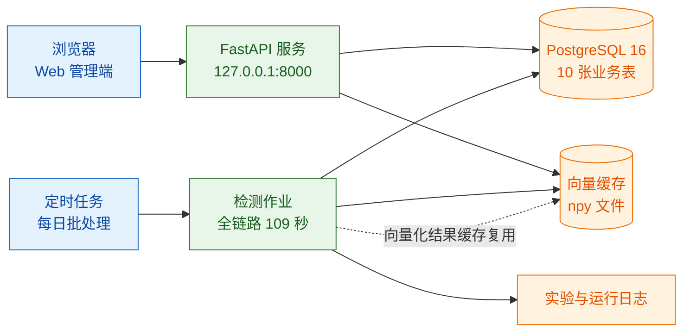

> 用途：放在论文第 7 章「系统部署与运行环境」小节，给出开发机配置、依赖清单，并用实测数据论证「不需要 GPU / 不需要 LLM / 不需要向量数据库」三个工程取舍。

# 图 7-1 系统开发与运行环境

## 7.1 开发机硬件配置

| 项目 | 配置 | 说明 |
| --- | --- | --- |
| GPU | NVIDIA GeForce RTX 4060 Laptop，显存 8188 MiB（8 GB） | 具备但实验中未参与计算，全部实验在 CPU 上完成 |
| CPU | AMD Ryzen 7 7840HS，8 核 16 线程 | 通过 numpy/scikit-learn 多线程 BLAS 承担全部计算 |
| 内存 | 31.2 GB | 1852 × 384 的 float32 矩阵仅约 2.8 MB，余弦矩阵 300 × 1852 约 2.2 MB，内存无压力 |
| 磁盘 | D 盘可用 144 GB | 存放数据集、向量缓存与实验输出 |
| 操作系统 | Windows 11 | 开发与实验环境 |
| Python | 3.11.9 | 运行时 |

## 7.2 软件依赖清单

| 依赖 | 版本 | 用途 | 是否必需 |
| --- | --- | --- | --- |
| FlagEmbedding | 1.4.2 | 加载与调用 BGE-small-zh-v1.5 文本编码器 | 必需 |
| scikit-learn | 1.9.0 | HDBSCAN 聚类、评价指标 | 必需 |
| numpy | 2.3.0 | 余弦相似度矩阵、reduceat 聚合 | 必需 |
| pandas | 2.3.0 | 数据读取与结果整理 | 必需 |
| torch | 随 FlagEmbedding 依赖 | CPU 推理后端 | 必需 |
| PostgreSQL | 16 | 10 张业务表持久化 | 必需（可由 SQLite 替代用于单机演示） |
| FastAPI | — | Web 服务层 | 服务化部署时必需 |
| 向量数据库 | 无 | 不引入 | **不需要**，理由见 7.4 |
| LLM 服务 | 无 | 不引入 | **不需要**，理由见 7.4 |

## 7.3 性能实测数据

| 指标 | 实测值 | 说明 |
| --- | --- | --- |
| 全链路耗时 | 109 s | 生成 1.1 s + 向量化 64.9 s + 检测 3.7 s |
| CPU 编码吞吐 | 123 条/秒 | BGE-small-zh 在 8 核 16 线程 CPU 上的稳定吞吐 |
| 文档段落规模 | 1852 段 / 300 篇 | 平均 6.2 段/篇 |
| 余弦矩阵 300×1852 | 秒级完成 | numpy 矩阵点积 |
| 余弦矩阵 2000×2000 | 400 万次点积 | 秒级完成 |
| HDBSCAN 聚类 | 1.55 s | 95 簇，噪声 0 条 |
| 覆盖度分布 | min 0.563 / mean 0.689 / max 0.829 | 分段最大值聚合 |
| 三模块 F1 | 缺口 0.800 / 腐化 0.9466 / 冗余 0.95 阈值组级 1.0 | 0.90 阈值下降至 0.7037 |
| 段落级 AUC | 0.968（整篇级 0.936） | 段落级更优 |

## 7.4 三项「不需要」的工程论证

### （1）不需要 GPU

**论据**：本系统全部算法均由「向量编码 + 稠密点积 + 传统机器学习」三部分构成。

- 编码环节：使用 BGE-small-zh-v1.5（约 100 MB 级的小模型）而非任何生成式模型，实测 CPU 吞吐 123 条/秒。全量 300 篇文档切分为 1852 段，加上 300 条工单，向量化阶段共耗时 64.9 秒，占全链路 109 秒的约六成，而检测阶段仅 3.7 秒。
- 相似度计算：300 × 1852 的余弦相似度矩阵由 numpy 一次矩阵点积完成，实测秒级；即便语料扩大到 2000 × 2000，也仅是 400 万次点积，仍在秒级完成，远未触及 CPU 的算力边界。
- 聚类与规则：HDBSCAN 在 300 条向量上耗时 1.55 秒；规则引擎是字符串与日期匹配，无矩阵运算。

**结论**：全链路 109 秒的绝对耗时已完全满足「每日定时批处理」的运维场景，无需引入 GPU 依赖，也避免了由此带来的环境配置成本与跨平台复现障碍。RTX 4060 的 8 GB 显存在整套实验中未被使用。

### （2）不需要 LLM

**论据**：系统的三个判定环节均可在无生成式模型的前提下完成，且实测精度已满足需求。

| 环节 | 传统方案 | 实测 F1 | 为何不需要 LLM |
| --- | --- | --- | --- |
| 知识缺口 | BGE 编码 + HDBSCAN + 覆盖度阈值 | 0.800 | 缺口判定只需「工单与文档的语义接近程度」这一标量，句向量即可提供；生成式回答反而需要先把不存在的知识编造出来 |
| 内容腐化 | 规则引擎（日期/版本/责任人/失效词） | 0.9466 | 过期事实是显式声明，规则命中即可精确解释「哪句话违反了时效」，这比模型判定的可解释性更强 |
| 重复冗余 | 段落级余弦矩阵 + 并查集 | 阈值 0.95 下组级 F1 = 1.0 | 冗余判定是纯相似性判定，无需语义改写或判断 |

**附加理由**：引入 LLM 会带来三方面代价——推理 Token 成本、结果的不确定性（同一输入多次判定可能不同，破坏治理结论的可复现性与审计价值）、以及 7B 级模型在 8 GB 显存下的部署约束。本系统选择「可解释、可复现、可审计」优先于「语义理解上限优先」，因此完全排除 LLM。

### （3）不需要向量数据库

**论据**：检索规模远低于任何专用向量库的适用区间。

- 数据规模：300 篇文档切成 1852 段，段向量为 384 维 float32，内存占用约 2.8 MB；工单向量 300 × 384 约 0.5 MB。
- 检索方式：采用**暴力全量点积**（numpy 矩阵乘法），300 × 1852 仅 55.6 万次乘加，秒级完成；即使扩展到 2000 × 2000 也仅 400 万次点积，仍在秒级。IVF/HNSW 等近似最近邻索引的价值在于百万级以上向量与高并发场景，本系统完全不在该区间。
- 持久化方案：向量以 `.npy` 文件或 PostgreSQL 的 `vector` 扩展列保存，随业务表一同事务备份，无需独立实例的运维。

**结论**：引入 Milvus / Qdrant / pgvector 独立部署会带来额外的进程管理、备份同步与版本兼容成本，而收益为零。系统采用 numpy 暴力检索 + 文件缓存，在实测吞吐下与专用向量库无性能差异，且整个系统仅需一个数据库进程。

## 7.5 部署拓扑

**图注建议**：图 7-1 给出系统的部署拓扑。系统由 Web 服务进程、数据库进程与定时批处理作业三部分构成：Web 服务提供治理看板与复核工作台；定时作业每日执行全链路检测，实测耗时 109 秒；检测过程中产生的向量结果写入缓存文件，并在次日检测中直接复用，因此日常运行的实际成本低于全量重跑。整套系统为单机部署，不依赖 GPU、LLM 服务与独立向量数据库。